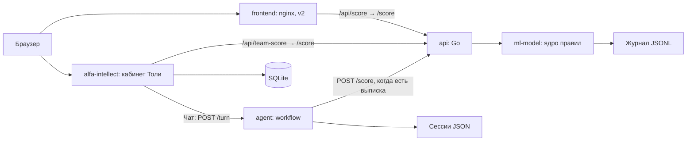

# Умный кредитный кабинет предпринимателя

Кредитный помощник для ИП и ООО: собирает потребность, считает выписку по правилам и объясняет готовность к финансированию.

## Попробовать за 2 минуты

1. Откройте [стенд](https://158-160-212-36.sslip.io) или [v2](https://158-160-212-36.sslip.io/v2/), затем [v2-чат](https://158-160-212-36.sslip.io/v2/chat.html).
2. Выберите демо-выписку: получите статус, инструмент, лимит сейчас и после шага, причины и следующие действия.
3. Откройте [кабинет Толи](http://158.160.212.36:4173), [демо без регистрации](http://158.160.212.36:4173/demo). Публичное демо показывает синтетический сценарий; для сохранения данных используйте демо-вход или регистрацию.

Стенд обновляется автоматически при каждом merge в main. Решение о кредите принимает банк.

## Как устроено



| Сервис | Язык | Порт хоста → контейнера | Ответственность | Владелец |
|---|---|---|---|---|
| frontend | HTML/CSS/JS, nginx | FRONTEND_PORT → 80 | Экраны, CSV, показ результата | Владелец реализации в AGENTS.md не закреплён; Тоня: сценарий и тексты |
| api | Go 1.22 | 8080 → 8080 | Прокси /score, ошибки upstream | Артём |
| ml-model | Python 3.11 | 127.0.0.1:5000 → 5000 | Валидация, ядро, перевод ответа, журнал | Лиза: ядро; Саша: обвязка |
| agent | Python 3.11 | Только сеть Compose: 8090 | Слоты, вопросы, объяснение, страж | Саша |
| alfa-intellect | TypeScript, React, Node 24 | ALFA_PORT → 4173 | Учётки, документы, подбор, кабинет, чат | Толя |

Агент устроен по [решению архитектора](context/agent-architecture.md): приёмщик → код-роутер → ядро → объяснялка → код-страж. Без ключей работают правила и шаблоны. Локальный подбор Толи `transparent-mvp-2` считает самостоятельно; вызов командного ядра идёт через `team-score`.

## Запуск и проверка за 5 минут

Нужны Docker с Compose v2 (поддержка необязательного `env_file.required`), свободные порты 80, 8080, 4173, 5000 и доступ к образам/npm при сборке. Для smoke нужен Python 3.11+; Node 24+ нужен только для локальных команд Толи. Потолки памяти контейнеров суммарно 864M плюс память Docker и сборки. Сборка Толи выполняет `npm ci`, генерацию fixtures и build.

Из корня репозитория:

```bash
docker compose up --build
```

Для фонового запуска и smoke:

```bash
docker compose up --build -d
python scripts/smoke.py --base http://localhost
node hw/tolya/alfa-intellect/scripts/smoke.mjs --base http://localhost:4173
docker stats --no-stream
```

При другом FRONTEND_PORT измените `--base`. Compose запускает зависимости по `service_started`, а готовность показывает healthcheck. При недоступном ядре API возвращает JSON 502, статика продолжает работать. Smoke печатает OK/FAIL и возвращает ненулевой код при ошибке. Smoke Толи допускает 502 командного ядра, поэтому отдельно проверьте успешный расчёт в v2.

Остановка: `docker compose down`. Именованные volumes `journal`, `agent_state`, `alfa_data` сохраняют данные. Не удаляйте их для обычного перезапуска.

## Конфигурация

Ниже только имена ключей, без значений. Корневого `.env.example` нет. Список основан на `docker-compose.yml` и [примере Толи](hw/tolya/alfa-intellect/.env.example). Необязательный корневой `.env` читает сервис agent; файл Толи предназначен для его отдельного запуска и автоматически в Compose не подключается.

| Ключи | Где используются и зачем |
|---|---|
| FRONTEND_PORT, ALFA_PORT | Подстановка внешних портов Compose |
| ML_URL, PORT | Адрес ядра для Go, порт HTTP сервисов |
| CORE_ID | Выбор ядра ml-model; Compose включает Лизино |
| AGENT_PORT, AGENT_CORE_URL | HTTP агента и адрес командного API |
| AGENT_STATE_DIR | Каталог сохранённых сессий агента |
| AGENT_LLM_URL, AGENT_LLM_MODEL | Endpoint и модель агента |
| DEEPSEEK_API_KEY | Необязательный ключ прямого API, читается кодом агента |
| OPENROUTER_API_KEY | Необязательный ключ локального eval, читается кодом агента |
| HOST, DATABASE_PATH | Интерфейс Node и путь SQLite |
| TEAM_API_URL, TEAM_AGENT_URL | Провода кабинета к API и агенту |
| EGR_PROVIDER | Выбор реестра; в Compose задан мок |
| DADATA_API_KEY, FNS_API_KEY | Необязательные провайдеры реестра при отдельном запуске |
| COOKIE_SECURE | Secure-cookie при отдельном HTTPS-развёртывании |
| OPENAI_API_KEY, AI_MODEL, AI_DAILY_CALL_LIMIT | Экспериментальный провайдер Толи; для проверки ключ не задавать |

Проверяемый вариант: без ключей LLM и реестров, с локальными моками. При `TEAM_AGENT_URL` кабинет выбирает командного агента раньше прочих провайдеров. DeepSeek/OpenRouter требуют сети, для основной проверки не нужны. Источник архитектуры и ограничения моделей: [agent-architecture](context/agent-architecture.md).

## Сценарий проверки жюри

1. Запустите Compose. Убедитесь, что `http://localhost:8080/health` и `http://localhost:4173/health` отвечают; у кабинета `db` должен быть `ok`.
2. На `http://localhost/v2/chat.html` выберите демо-выписку или загрузите `data/synthetic/cash_gap.csv`. Проверьте ответ ядра: статус, инструмент, два лимита, причины. Параметры нужды и анкеты в v2-чате фиксированы для демо.
3. Для вариантов с другими нуждами используйте golden и [коллекцию запросов](docs/requests.http). Полученный статус не означает банковского одобрения.
4. На `http://localhost:4173/demo` посмотрите публичный пример; затем через демо-вход создайте отдельное рабочее пространство либо зарегистрируйте синтетическую учётку.
5. В профиле найдите ИНН `9900000001`, проверьте метку мока и подтвердите результат. Загрузите `hw/tolya/alfa-intellect/fixtures/statement.csv`, проверьте извлечённые показатели и подтвердите документ.
6. Пройдите подбор, измените сумму или срок, сохраните новую версию. Посмотрите предупреждения и предварительный вид заявки, подтвердите риски при запросе и создайте демо-заявку. Она остаётся в SQLite, в банк ничего не отправляется.
7. В отдельном чате напишите «Нужны деньги на оборудование», затем ответьте про сумму, источник возврата и срок. Агент собирает слоты и просит выписку. Передача файла из кабинета в `/turn` пока не реализована: полный расчёт этим чатом не заявляем.
8. Обновите страницу кабинета: данные сохраняются. Выполните smoke и golden по [тестовым сценариям](docs/test-scenarios.md).

## Что настоящее, что смоделировано

Настоящее: ядро на экспертных правилах, расчёт потока и лимитов, HTTP-провода, хранение SQLite, разбор документов, диалог со слотами, проверка объяснения, журнал с цепочкой хэшей. Это не обученная кредитная модель.

Синтетика: выписки, компании, документы, ставки каталога, демо-кредит. ЕГРЮЛ/ЕГРИП воспроизведены локальным мок-реестром. БКИ не подключено. Банковские решения и операции представлены демонстрационными расчётами и локальным сохранением; статусов банковского рассмотрения, реальной выдачи и подписи нет. Другие страницы и сцены v2 в основном макеты; `/anketa.html`, `/razgovor.html` и расчёт CSV в `/v2/chat.html` обращаются к ядру.

## Документы и данные

- [Архитектура и последовательности](docs/architecture.md), [API и OpenAPI 3.1](docs/openapi.yaml), [REST Client](docs/requests.http).
- [Состояния](docs/application-states.md), [модель данных](docs/data-model.md), [проверки и тест-учётки](docs/test-scenarios.md).
- [Сторонние компоненты](THIRD_PARTY_NOTICES.md), [предложения по приборке](docs/CLEANUP.md).
- [Golden](data/golden.json), [синтетические выписки и генераторы](data/synthetic/), [fixtures кабинета](hw/tolya/alfa-intellect/fixtures/).
- [Правила ядра](context/core.md), [стоп-правила](context/stop-rules.md), [контракт](context/api-contract.md), [агент](context/agent-architecture.md).

## Разработка и проверка ядра

Python-обвязка запускается отдельно без pip: `python services/ml-model/app.py`; проверка: `curl http://localhost:5000/health`. Ядро: `services/ml-model/core.py`, функция `score(statement_csv, need, questionnaire)`.

```bash
python data/check_golden.py -k cash_gap
python data/check_golden.py
python data/check_golden.py --reference
```

Последняя команда проверяет эталон, а не ядро Лизы. `CORE_ID=liza` выбирает ядро в HTTP-обвязке; `stub` оставлен для известных тестовых выписок. Список клиентов и ожидания в golden, не в тексте README.

Агент хранит слоты, need и view в `agent_state`; CSV на диск не пишет, сохраняет хэш и признак получения. После перезапуска для нового расчёта CSV нужен снова. SQLite кабинета, напротив, хранит загруженные файлы как BLOB.

Код сдаём в ветке `<имя>/<задача>` через PR. Работа каждого в `hw/<имя>/`, контекст в `context/`, инструкции в `AGENTS.md`. Репозиторий конфиденциальный, наружу не публикуем; доступ жюри и идентификатор версии на дедлайн фиксирует капитан. Сдача 26.10.2026 в 18:00 на LMS.
