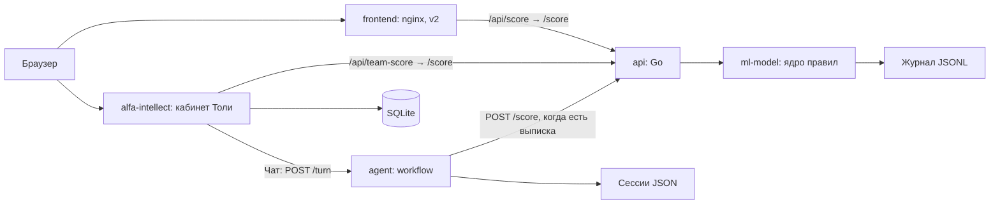

<p align="center"></p>

<p align="center">
<a href="https://alphahack.ru"><b>Открыть кабинет</b></a> ·
<a href="https://alphahack.ru/demo">Демо без регистрации</a> ·
<a href="docs/demo-script.md">Сценарий жюри</a> ·
<a href="docs/openapi.yaml">API</a> ·
<a href="#что-настоящее-что-смоделировано">Что настоящее</a> ·
<a href="docs/journey.md">О проекте</a> ·
<a href="#команда">Команда</a>
</p>

# Умный кредитный кабинет предпринимателя

> **Для жюри за 5 минут.** Нужен только Docker: `docker compose up --build` из корня, затем http://localhost:4173. LLM не обязательна: без модели агент работает на шаблонах, ядро и весь путь клиента и менеджера доступны. Учётки создаёт сид (менеджер `79990000500`, клиенты `79990000501`..`79990000504`), шаги в разделе [Сценарий проверки жюри](#сценарий-проверки-жюри). На стенде весь стек в простое занимает около 190 МБ RAM (`docker stats`, 26.10), потолки контейнеров 1120M. Упрощения перечислены в разделе [Что настоящее, что смоделировано](#что-настоящее-что-смоделировано).

Кредитный помощник для ИП и ООО: собирает потребность, считает выписку по правилам и объясняет готовность к финансированию.

<p align="center"></p>

## Попробовать за 2 минуты

1. Откройте [кабинет](https://alphahack.ru) или [демо без регистрации](https://alphahack.ru/demo). Публичное демо показывает синтетический сценарий; для сохранения данных используйте демо-вход или регистрацию.
2. Пройдите онбординг и загрузите демо-выписку: получите статус, инструмент, лимит сейчас и после шага, причины и следующие действия.
3. Расчёт ядра напрямую: [v2-чат](https://158-160-212-36.sslip.io/v2/chat.html), выберите демо-выписку.

<p align="center"></p>

Публичный стенд развёрнут в Yandex Cloud тем же `docker compose`. Решение о кредите принимает банк.

## Как устроено



| Сервис | Язык | Порт хоста → контейнера | Ответственность | Владелец |
|---|---|---|---|---|
| frontend | HTML/CSS/JS, nginx | FRONTEND_PORT → 80 | Экраны, CSV, показ результата | Владелец реализации в AGENTS.md не закреплён; Тоня: сценарий и тексты |
| api | Go 1.22 | 127.0.0.1:8080 → 8080 | Прокси /score, ошибки upstream | Артём |
| ml-model | Python 3.11 | Только сеть Compose: 5000 | Валидация, ядро, перевод ответа, журнал | Лиза: ядро; Саша: обвязка |
| agent | Python 3.11 | Только сеть Compose: 8090 | Слоты, вопросы, объяснение, страж | Саша |
| alfa-intellect | TypeScript, React, Node 24 | ALFA_PORT → 4173 | Учётки, документы, подбор, кабинет, чат | Толя |

Агент устроен по [решению архитектора](context/agent-architecture.md): приёмщик → код-роутер → ядро → объяснялка → код-страж. При пустом `AGENT_LLM_URL` работают правила и шаблоны. Локальный подбор Толи `transparent-mvp-2` считает самостоятельно; вызов командного ядра идёт через `team-score`.

## Запуск и проверка за 5 минут

Нужны Docker с Compose v2 (поддержка необязательного `env_file.required`), свободные порты 80, 8080, 4173 и доступ к образам/npm при сборке. Для smoke нужен Python 3.11+; Node на хосте не нужен, smoke кабинета запускается внутри контейнера. Потолки памяти основных контейнеров суммарно 1120M плюс память Docker и сборки. Сборка кабинета выполняет `npm ci`, генерацию fixtures и build.

Из корня репозитория:

```bash
docker compose up --build
```

Для фонового запуска и smoke:

```bash
docker compose up --build -d
python scripts/smoke.py --base http://localhost
docker compose exec -T alfa-intellect node scripts/smoke.mjs --base http://127.0.0.1:4173
docker stats --no-stream
```

При другом FRONTEND_PORT измените `--base`. Compose запускает зависимости по `service_started`, а готовность показывает healthcheck. При недоступном ядре API возвращает JSON 502, статика продолжает работать. Smoke печатает OK/FAIL и возвращает ненулевой код при ошибке. Smoke Толи допускает 502 командного ядра, поэтому отдельно проверьте успешный расчёт в v2.

Остановка: `docker compose down`. Именованные volumes `journal`, `agent_state`, `alfa_data` сохраняют данные. Не удаляйте их для обычного перезапуска.

## Конфигурация

Все параметры меняются в файле `.env`, код править не нужно. Шаблон со всеми параметрами: [`.env.example`](.env.example) (адрес провайдера, имя модели, пустое поле ключа, таймаут, порты).

1. Скопируйте шаблон: `cp .env.example .env` (Windows PowerShell: `Copy-Item .env.example .env`).
2. Для опциональной модели задайте `AGENT_LLM_URL` (base URL OpenAI-совместимого API, например `https://openrouter.ai/api/v1`; полный путь `/chat/completions` тоже принимается), `AGENT_LLM_MODEL`, при необходимости `AGENT_LLM_API_KEY`. Для режима без модели оставьте `AGENT_LLM_URL=` пустым.
3. Запустите `docker compose up --build`. После правки `.env` перезапуск: `docker compose up -d --build`.

`.env` исключён из git. Настоящий API-ключ в репозиторий не добавляется, в шаблоне поле ключа пустое. Без `.env` Compose запускает режим без модели, без запросов к LLM. Compose подставляет значения `.env` в `docker-compose.yml`, а сервис agent ещё и получает весь файл как окружение, поэтому необязательные `AGENT_LLM_TIMEOUT` и `AGENT_LLM_PROXY` тоже работают из `.env`. Файл [примера кабинета](hw/tolya/alfa-intellect/.env.example) нужен только для его отдельного запуска без Compose.

Параметры запуска через Compose перечислены в `.env.example`:

| Ключи | Где используются и зачем |
|---|---|
| FRONTEND_PORT, ALFA_PORT | Подстановка внешних портов Compose |
| AGENT_LLM_URL, AGENT_LLM_API_KEY, AGENT_LLM_MODEL | Base URL, необязательный ключ и модель агента; пустой URL отключает LLM |
| AGENT_LLM_TIMEOUT | Таймаут вызова модели в секундах, по умолчанию 30 |
| AGENT_LLM_PROXY | Необязательный HTTP-прокси для модели |
| AGENT_LLM_REASONING, AGENT_LLM_PROVIDER | Опции OpenRouter: reasoning (0 по умолчанию) и провайдер инференса |
| AGENT_MEMORY | Память клиента между сессиями, по умолчанию 0 |
| FEEDBACK_EXPORT_TOKEN | Токен командной выгрузки отзывов; пустое значение закрывает выгрузку |

Внутренние адреса API, ядра и агента, пути volumes и `EGR_PROVIDER=mock` заданы в Compose. Параметры отдельного запуска кабинета описаны в его собственном шаблоне. При `TEAM_AGENT_URL` кабинет обращается к командному агенту; без него или при ошибке использует программный DemoProvider. Случайный ключ OpenAI в окружении не включает экспериментального провайдера кабинета.

## Модель

Основной сценарий проходит без модели. Чтобы гарантированно отключить её без попыток сети, добавьте в корневой `.env` строку с пустым значением (также работает в Windows PowerShell, где пустая переменная окружения может удаляться):

```dotenv
AGENT_LLM_URL=
```

Затем запустите `docker compose up --build`. Агент не читает `.env` сам: при отдельном запуске Python переменные должны быть переданы окружением. Это отключает запросы LLM, внутренний вызов расчётного API при получении выписки сохраняется.

Опциональная модель: [Qwen3-8B](https://huggingface.co/Qwen/Qwen3-8B), открытые веса, лицензия Apache 2.0 указана в карточке весов. Установите [Ollama](https://ollama.com) на хосте и загрузите модель заранее:

```bash
ollama pull qwen3:8b
ollama serve
```

Если служба Ollama уже работает, второй `ollama serve` не нужен. Ollama и веса в репозиторий не входят. Для режима без модели веса не требуются. Необходимая RAM зависит от квантования и контекста; модель работает вне лимита 96M контейнера агента.

В корневом `.env` задайте base URL, имя модели и при необходимости ключ. Для Ollama на хосте при запуске через Compose:

```dotenv
AGENT_LLM_URL=http://host.docker.internal:11434/v1
AGENT_LLM_API_KEY=
AGENT_LLM_MODEL=qwen3:8b
```

При запуске Python вне Docker адрес Ollama: `http://127.0.0.1:11434/v1`. Полный путь `/v1/chat/completions` тоже принимается. Пробелы по краям и хвостовой `/` удаляются; `/chat/completions` добавляется, если его ещё нет. На Linux в Compose добавлен `host-gateway`; Ollama должна слушать интерфейс, доступный контейнеру. Настройте bind и firewall хоста без открытия сервиса в интернет.

Пустой ключ означает отсутствие заголовка Authorization. Внешний OpenAI-совместимый провайдер моделей с открытыми весами (например OpenRouter, Cloud.ru) подключается теми же тремя переменными: base URL, модель и ключ. Ошибки соединения, HTTP, формата ответа и таймаут приводят к шаблону; кабинет ограничивает ожидание агента 35 секундами и затем отвечает программно. OpenRouter-поля reasoning/provider добавляются только для URL OpenRouter; профиль `egress` не запускается обычным `docker compose up`.

`POST /turn` принимает необязательное `card.application`: `{id, status, n, m, holes, reasons, stops_fired, limit_now_rub, alternatives, red_reason}`. Контекст заявки объясняется шаблоном без повторного скоринга. `mode: "nudge"` формирует напоминание по недостающим данным в `info_requested` (допустим пустой `text`); `mode: "objections"` объясняет переданные альтернативы и возвращает `objections_summary`, до трёх дословных реплик клиента. Это формирование ответа, события заявки и отправку сообщений выполняет вызывающая сторона. Без контекста и режима действует прежний диалог.

В адаптере кабинета четвёртый аргумент `provider.reply(state, history, selectionId, {application, mode})` передаёт этот контекст и возвращает `objections_summary`. Загрузку актуального досье, проверку доступа к заявке и вызов адаптера с этим аргументом должен подключить обработчик приложения; существующий общий чат пока вызывает адаптер без контекста заявки.

## Как проверить ИИ

По умолчанию модель отключена. После запуска Compose скопируйте скрипт в контейнер агента и выполните его там (команды подходят для bash и PowerShell):

```bash
docker compose cp scripts/check_ai.py agent:/tmp/check_ai.py
docker compose exec -T agent python /tmp/check_ai.py
```

Скрипт читает `/health` и выполняет три хода. При `llm=templates` ожидает только `source=template` и возвращает 0. Флаг `--expect-template` явно требует только шаблоны. Порт агента 8090 доступен только внутри Compose.

Для проверки модели задайте в `.env` `AGENT_LLM_URL` как base URL (полный путь тоже принимается), `AGENT_LLM_MODEL` и при необходимости `AGENT_LLM_API_KEY`, затем выполните `docker compose up -d --build` и две команды выше. При включённой модели хотя бы один ответ `source=llm` даёт код 0; только шаблоны дают код 1 с подсказкой проверить настройки. Ошибка соединения с агентом даёт код 2.

При отдельном запуске агента на хосте используйте `python scripts/check_ai.py`; другой адрес задаётся через `--url http://127.0.0.1:8090`. Скрипт печатает модель, источник и начало каждого ответа.

Поле `source` в JSON ответа `POST /turn` отличает успешный ход модели (`llm`) от шаблона (`template`). Шаблон используется, если модель выключена, недоступна, превысила таймаут или её ответ отклонён стражем. Контекст заявки `card.application` и режимы `nudge`/`objections` также всегда используют шаблоны. Имя модели в `/health` само по себе не подтверждает успешный вызов.

OCR не используется: кабинет читает PDF только с текстовым слоем (pdf-parse), сканы отклоняются с сообщением; модели распознавания выписок в решении нет.

## Сценарий проверки жюри

Один процесс с двумя ролями: клиент подаёт заявку и досылает сведения, менеджер рассматривает досье, клиент получает оффер или отказ с причинами. Подробные ветки и API-проверки: [демо-сценарий](docs/demo-script.md).

1. Запустите Compose. Проверьте `http://localhost:8080/health` и `http://localhost:4173/health`: у кабинета `db` должен быть `ok`. Подготовьте очередь в той же SQLite, которую использует кабинет:

   ```bash
   docker compose exec -T -e AI_PROVIDER= -e TEAM_AGENT_URL= -e EGR_PROVIDER=mock alfa-intellect npx --no-install tsx scripts/seed-manager.ts
   ```

   Сид требует доступного ядра. На новой базе он создаёт менеджера `79990000500`, клиентов `79990000501`..`79990000504` и четыре заявки. Сохраните напечатанные пароли: они выводятся только при первом создании. Повторный запуск сохраняет пароли и решения.
2. Клиентская подача без сида: откройте `http://localhost:4173`, зарегистрируйте синтетическую учётку или используйте демо-вход. В профиле найдите ИНН `9900000001`, проверьте метку мока и подтвердите данные. Загрузите и подтвердите `hw/tolya/alfa-intellect/fixtures/statement.csv`. В «Финансировании» выберите условия и нажмите «Отправить заявление». Заявка поступает в машину состояний: полные данные в пределах лимита дают оффер, недостающие сведения вызывают дозапрос, стоп проверки даёт отказ с причиной.
3. Банковская роль: в отдельном профиле браузера войдите менеджером `79990000500` с паролем из сида. До подачи новых заявок в «Очереди» четыре заявки. Откройте досье: готовность N/M, проверки, недостающие данные, лимит, альтернативы и журнал событий. У клиента `79990000503` короткая выписка: в форме «Запросить документ» выберите недостающую выписку, напишите запрос и отправьте его. Галочка «Вернуть мне после досылки» возвращает заявку менеджеру даже при зелёном пересчёте.
4. Клиентская роль: войдите клиентом `79990000503` с паролем из сида. В «Моей заявке» загрузите и подтвердите запрошенный документ, выберите его и нажмите «Дослать». Выполняется повторный скоринг. При зелёном результате без галочки менеджера оффер выдаётся автоматически; иначе смотрите текущие причины и результат в досье. Загрузчик поддерживает финансовые шаблоны; досылка подтверждённых договора и акта из ветки S-менеджер проверяется через API, не через этот загрузчик.
5. Рассмотрение и оффер: под менеджером откройте заявку `79990000502` с несогласием клиента. Выберите альтернативу в пределах лимита, заполните записку андеррайтеру и нажмите «Предложить вариант». В открывшейся записке отметьте «Я проверил досье и согласен с запиской» и нажмите «Передать андеррайтеру». Передача на андеррайтинг запускает автоматические переходы `underwriting → approved → offered`. Сумма сверх лимита блокируется. Менеджер также может отказать заявке в очереди, указав причину.
6. Результат у клиента: войдите `79990000502`, откройте оффер и график платежей, нажмите «Подписать договор» и введите демонстрационный код `0000`. Переход `signed` автоматически вызывает `disbursed` с сообщением «Деньги на счёте». Это демонстрационная выдача, реальных денег нет. При отказе клиент видит причину. Обновите страницу: состояние и журнал сохраняются.

Дополнительно на `http://localhost/v2/chat.html` выберите демо-выписку или загрузите `data/synthetic/cash_gap.csv`: ядро вернёт статус, инструмент, два лимита и причины. Параметры нужды и анкеты здесь фиксированы для демо; другие варианты проверяются через golden и [коллекцию запросов](docs/requests.http). В Compose используйте внешний Go API `http://localhost:8080/score`; прямой адрес ml-model доступен только внутри сети контейнеров. В отдельном чате кабинета можно проверить сбор потребности, суммы, источника возврата и срока. Передача файла из этого чата в `/turn` пока не реализована.

## Что настоящее, что смоделировано

Реализованы: процесс рассмотрения в кабинете, роли client/manager/system, очередь менеджера, дозапрос и повторный скоринг, альтернативы, оффер и график платежей, переходы подписи и выдачи, отказы с причинами и журнал событий. Работают ядро на экспертных правилах, расчёт потока и лимитов, HTTP API, SQLite, разбор документов, диалог со слотами, проверка объяснения и журнал с цепочкой хэшей. Ядро не является обученной кредитной моделью.

Синтетические данные: компании, выписки, документы и ставки каталога. ЕГРЮЛ/ЕГРИП представлены мок-реестром; реального подключения БКИ нет. Подпись демонстрационная, по коду подтверждения без SMS. Выдача меняет состояние заявки, реального перевода денег нет. Другие страницы и сцены v2 в основном макеты; `/anketa.html`, `/razgovor.html` и расчёт CSV в `/v2/chat.html` обращаются к ядру.

## Дизайн

<p align="center"></p>

Дизайн-система «Живой узор v2»: у каждого цвета одна роль, синтетические данные помечены синим бейджем, агент сворачивается в правый нижний угол. Картинки README анимированы и учитывают тёмную тему и `prefers-reduced-motion`.

## Документы и данные

- [Архитектура и последовательности](docs/architecture.md), [API и OpenAPI 3.1](docs/openapi.yaml), [REST Client](docs/requests.http).
- [Состояния](docs/application-states.md), [модель данных](docs/data-model.md), [проверки и тест-учётки](docs/test-scenarios.md).
- [О проекте: путь и выборы](docs/journey.md), [как кабинет встраивается в банк](docs/bank-integration.md), [сторонние компоненты](THIRD_PARTY_NOTICES.md).
- [Golden](data/golden.json), [синтетические выписки и генераторы](data/synthetic/), [fixtures кабинета](hw/tolya/alfa-intellect/fixtures/).
- [Правила ядра](context/core.md), [стоп-правила](context/stop-rules.md), [контракт](context/api-contract.md), [агент](context/agent-architecture.md).

## Разработка и проверка ядра

Проверка ядра внутри Compose: `docker compose exec -T ml-model python -c "import urllib.request; print(urllib.request.urlopen('http://127.0.0.1:5000/health').read().decode())"`. Python-обвязка для отдельной разработки запускается без pip: `python services/ml-model/app.py`. Ядро: `services/ml-model/core.py`, функция `score(statement_csv, need, questionnaire)`.

```bash
python data/check_golden.py -k cash_gap
python data/check_golden.py
python data/check_golden.py --reference
```

Последняя команда проверяет эталон, а не ядро Лизы. `CORE_ID=liza` выбирает ядро в HTTP-обвязке; `stub` оставлен для известных тестовых выписок. Список клиентов и ожидания в golden, не в тексте README.

Агент хранит слоты, need и view в `agent_state`; CSV на диск не пишет, сохраняет хэш и признак получения. После перезапуска для нового расчёта CSV нужен снова. SQLite кабинета, напротив, хранит загруженные файлы как BLOB.

Код сдаём в ветке `<имя>/<задача>` через PR. Работа каждого в `hw/<имя>/`, контекст в `context/`, инструкции в `AGENTS.md`. Репозиторий конфиденциальный, наружу не публикуем; доступ жюри и идентификатор версии на дедлайн фиксирует капитан. Сдача 26.10.2026 в 18:00 на LMS.

Для команды: оценки ответов и история выгружаются командой `python scripts/pull_history.py --base http://localhost:4173` с `FEEDBACK_EXPORT_TOKEN` в окружении или `~/.config/credit-cabinet/token`. Результат сохраняется вне репозитория в `~/projects/credit-cabinet-history`, повторный запуск докачивает изменения.

## Команда

<table>
<tr>
<td align="center" width="20%"><a href="https://github.com/alexregrets"></a><br><b>Саша</b><br><sub>капитан · агент · контракты · eval · выкатка</sub></td>
<td align="center" width="20%"><a href="https://github.com/Elizaveta11-me"></a><br><b>Лиза</b><br><sub>ядро скоринга · стоп-правила · пороги · коды причин</sub></td>
<td align="center" width="20%"><a href="https://github.com/tolyapolya2006-png"></a><br><b>Толя</b><br><sub>кабинет клиента и менеджера · заявка · подбор продуктов</sub></td>
<td align="center" width="20%"><a href="https://github.com/bwr1337"></a><br><b>Тёма</b><br><sub>API на Go · хранилище · безопасность · Docker</sub></td>
<td align="center" width="20%"><a href="https://github.com/nekhaevaaa"></a><br><b>Тоня</b><br><sub>концепт · путь предпринимателя · тексты · макеты</sub></td>
</tr>
</table>
