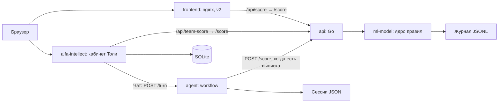

# Умный кредитный кабинет предпринимателя

Кредитный помощник для ИП и ООО: собирает потребность, считает выписку по правилам и объясняет готовность к финансированию.

## Попробовать за 2 минуты

1. Откройте [стенд](https://158-160-212-36.sslip.io) или [v2](https://158-160-212-36.sslip.io/v2/), затем [v2-чат](https://158-160-212-36.sslip.io/v2/chat.html).
2. Выберите демо-выписку: получите статус, инструмент, лимит сейчас и после шага, причины и следующие действия.
3. Откройте [кабинет Толи](http://158.160.212.36:4173), [демо без регистрации](http://158.160.212.36:4173/demo). Публичное демо показывает синтетический сценарий; для сохранения данных используйте демо-вход или регистрацию.

Стенд обновляется автоматически при каждом merge в main. Решение о кредите принимает банк.

## Фидбек и история
Оцените ответ 👍/👎; итоговая карточка спрашивает, насколько легко удалось разобраться с задачей (1–7).
Получите у команды `FEEDBACK_EXPORT_TOKEN` и задайте его в окружении или сохраните в `~/.config/credit-cabinet/token`.
Скачайте: `python scripts/pull_history.py --base http://158.160.212.36:4173`.
Файлы `history-<дата>.jsonl`, `feedback-<дата>.jsonl` и `state.json` появятся в `~/projects/credit-cabinet-history` вне репозитория.
Повторный запуск докачивает изменения; ПДн замаскированы, пользователь обозначен SHA-256, недоступный трейс — `null`.

## Как устроено



| Сервис | Язык | Порт хоста → контейнера | Ответственность | Владелец |
|---|---|---|---|---|
| frontend | HTML/CSS/JS, nginx | FRONTEND_PORT → 80 | Экраны, CSV, показ результата | Владелец реализации в AGENTS.md не закреплён; Тоня: сценарий и тексты |
| api | Go 1.22 | 8080 → 8080 | Прокси /score, ошибки upstream | Артём |
| ml-model | Python 3.11 | 127.0.0.1:5000 → 5000 | Валидация, ядро, перевод ответа, журнал | Лиза: ядро; Саша: обвязка |
| agent | Python 3.11 | Только сеть Compose: 8090 | Слоты, вопросы, объяснение, страж | Саша |
| alfa-intellect | TypeScript, React, Node 24 | ALFA_PORT → 4173 | Учётки, документы, подбор, кабинет, чат | Толя |

Агент устроен по [решению архитектора](context/agent-architecture.md): приёмщик → код-роутер → ядро → объяснялка → код-страж. При пустом `AGENT_LLM_URL` работают правила и шаблоны. Локальный подбор Толи `transparent-mvp-2` считает самостоятельно; вызов командного ядра идёт через `team-score`.

## Запуск и проверка за 5 минут

Нужны Docker с Compose v2 (поддержка необязательного `env_file.required`), свободные порты 80, 8080, 4173, 5000 и доступ к образам/npm при сборке. Для smoke нужен Python 3.11+; Node 24+ нужен только для локальных команд Толи. Потолки памяти контейнеров суммарно 864M плюс память Docker и сборки. Сборка Толи выполняет `npm ci`, генерацию fixtures и build.

Из корня репозитория:

```bash
docker compose up --build
```

Для фонового запуска и smoke:

```bash
docker compose up --build -d
python scripts/smoke.py --base http://localhost
node hw/tolya/alfa-intellect/scripts/smoke.mjs --base http://localhost:4173
docker stats --no-stream
```

При другом FRONTEND_PORT измените `--base`. Compose запускает зависимости по `service_started`, а готовность показывает healthcheck. При недоступном ядре API возвращает JSON 502, статика продолжает работать. Smoke печатает OK/FAIL и возвращает ненулевой код при ошибке. Smoke Толи допускает 502 командного ядра, поэтому отдельно проверьте успешный расчёт в v2.

Остановка: `docker compose down`. Именованные volumes `journal`, `agent_state`, `alfa_data` сохраняют данные. Не удаляйте их для обычного перезапуска.

## Конфигурация

Все параметры меняются в файле `.env`, код править не нужно. Шаблон со всеми параметрами: [`.env.example`](.env.example) (адрес провайдера, имя модели, пустое поле ключа, таймаут, порты).

1. Скопируйте шаблон: `cp .env.example .env` (Windows PowerShell: `Copy-Item .env.example .env`).
2. Заполните модель агента: `AGENT_LLM_URL` (полный адрес OpenAI-совместимого `/v1/chat/completions`), `AGENT_LLM_MODEL`, при необходимости `AGENT_LLM_API_KEY`. Для режима без модели оставьте `AGENT_LLM_URL=` пустым.
3. Запустите `docker compose up --build`. После правки `.env` перезапуск: `docker compose up -d --build`.

`.env` исключён из git. Настоящий API-ключ в репозиторий не добавляется, в шаблоне поле ключа пустое. Без `.env` Compose берёт значения по умолчанию из `docker-compose.yml`: локальная Ollama и `qwen3:8b`. Compose подставляет значения `.env` в `docker-compose.yml`, а сервис agent ещё и получает весь файл как окружение, поэтому необязательные `AGENT_LLM_TIMEOUT` и `AGENT_LLM_PROXY` тоже работают из `.env`. Файл [примера Толи](hw/tolya/alfa-intellect/.env.example) нужен только для отдельного запуска кабинета без Compose.

Полный список ключей:

| Ключи | Где используются и зачем |
|---|---|
| FRONTEND_PORT, ALFA_PORT | Подстановка внешних портов Compose |
| ML_URL, PORT | Адрес ядра для Go, порт HTTP сервисов |
| CORE_ID | Выбор ядра ml-model; Compose включает Лизино |
| AGENT_PORT, AGENT_CORE_URL | HTTP агента и адрес командного API |
| AGENT_STATE_DIR | Каталог сохранённых сессий агента |
| AGENT_LLM_URL, AGENT_LLM_API_KEY, AGENT_LLM_MODEL | Endpoint, необязательный ключ и модель агента; пустой URL отключает LLM |
| AGENT_LLM_TIMEOUT | Таймаут вызова модели в секундах, по умолчанию 30 |
| DEEPSEEK_API_KEY, OPENROUTER_API_KEY | Старые ключи только для соответствующих URL, опционально, не для проверки |
| HOST, DATABASE_PATH | Интерфейс Node и путь SQLite |
| TEAM_API_URL, TEAM_AGENT_URL | Провода кабинета к API и агенту |
| EGR_PROVIDER | Выбор реестра; в Compose задан мок |
| DADATA_API_KEY, FNS_API_KEY | Необязательные провайдеры реестра при отдельном запуске |
| COOKIE_SECURE | Secure-cookie при отдельном HTTPS-развёртывании |
| AI_PROVIDER, OPENAI_API_KEY, AI_MODEL, AI_DAILY_CALL_LIMIT | Экспериментальный провайдер кабинета включается только при AI_PROVIDER=openai; не для проверки |

Проверяемый вариант: `AGENT_LLM_URL=` и локальные моки реестров. По умолчанию кабинет выбирает командного агента при `TEAM_AGENT_URL`, иначе программный DemoProvider; ошибка агента также возвращает DemoProvider. Случайный ключ OpenAI в окружении не включает платный провайдер. DeepSeek и OpenRouter: опционально, не для проверки.

## Модель

Основной сценарий проходит без модели. Чтобы гарантированно отключить её без попыток сети, добавьте в корневой `.env` строку с пустым значением (также работает в Windows PowerShell, где пустая переменная окружения может удаляться):

```dotenv
AGENT_LLM_URL=
```

Затем запустите `docker compose up --build`. Агент не читает `.env` сам: при отдельном запуске Python переменные должны быть переданы окружением. Это отключает запросы LLM, внутренний вызов расчётного API при получении выписки сохраняется.

Опциональная модель: Qwen3-8B с открытыми весами, Apache 2.0. Выбор рассчитан на CPU и ПК с 8-16 ГБ RAM, но на 8 ГБ запас для Docker и контекста небольшой. Размер Q4 ориентировочно около 5 ГБ, рабочей памяти нужно больше размера весов. Тег сверить на ollama.com/library перед сдачей; размер, лицензия конкретного артефакта и производительность в этой среде не проверены. Установите Ollama на хосте по инструкции поставщика, запустите его службу и загрузите веса заранее:

```bash
ollama pull qwen3:8b
ollama serve
```

Если служба Ollama уже запущена, второй экземпляр `ollama serve` не нужен. Эти команды здесь не проверены, Ollama и веса в репозиторий не входят. Для офлайн-проверки загрузка весов не требуется. По умолчанию Compose обращается к `http://host.docker.internal:11434/v1/chat/completions`, Python вне Docker к `http://127.0.0.1:11434/v1/chat/completions`. На Linux добавлен `host-gateway`; Ollama должна слушать интерфейс, доступный контейнеру. Настройте bind и firewall хоста, не открывая сервис в интернет. Модель работает вне лимита 96M контейнера агента.

Свой OpenAI-совместимый провайдер подключается тремя переменными (URL полный, включая путь):

```dotenv
AGENT_LLM_URL=http://127.0.0.1:11434/v1/chat/completions
AGENT_LLM_API_KEY=
AGENT_LLM_MODEL=qwen3:8b
```

Пустой ключ означает отсутствие заголовка Authorization. В проверяемой версии используйте локальную модель с открытыми весами. Ошибки соединения, HTTP, формата ответа и таймаут приводят к шаблону; кабинет ограничивает ожидание агента 35 секундами и затем отвечает программно. OpenRouter-поля reasoning/provider добавляются только для URL OpenRouter; профиль `egress` не запускается обычным `docker compose up`.

`POST /turn` принимает необязательное `card.application`: `{id, status, n, m, holes, reasons, stops_fired, limit_now_rub, alternatives, red_reason}`. Контекст заявки объясняется шаблоном без повторного скоринга. `mode: "nudge"` формирует напоминание по недостающим данным в `info_requested` (допустим пустой `text`); `mode: "objections"` объясняет переданные альтернативы и возвращает `objections_summary`, до трёх дословных реплик клиента. Это формирование ответа, события заявки и отправку сообщений выполняет вызывающая сторона. Без контекста и режима действует прежний диалог.

В адаптере кабинета четвёртый аргумент `provider.reply(state, history, selectionId, {application, mode})` передаёт этот контекст и возвращает `objections_summary`. Загрузку актуального досье, проверку доступа к заявке и вызов адаптера с этим аргументом должен подключить обработчик приложения; существующий общий чат пока вызывает адаптер без контекста заявки.

## Как проверить ИИ

С моделью: заполните в `.env` переменные `AGENT_LLM_URL`, `AGENT_LLM_MODEL`, `AGENT_LLM_API_KEY` (ключ при необходимости), выполните `docker compose up -d --build`, затем `python scripts/check_ai.py`. Скрипт печатает модель из `/health`, для каждой реплики источник и начало ответа. Хотя бы одна строка `source=llm` даёт код выхода 0.

Порт агента 8090 доступен только внутри Compose. Для этого запуска скопируйте скрипт в контейнер и выполните проверку там (также работает в PowerShell):

```bash
docker compose cp scripts/check_ai.py agent:/tmp/check_ai.py
docker compose exec -T agent python /tmp/check_ai.py
```

При отдельном запуске агента на хосте используйте `python scripts/check_ai.py`; другой адрес задаётся через `--url http://127.0.0.1:8090`.

Без модели: оставьте `AGENT_LLM_URL=` пустым в `.env`, перезапустите `docker compose up -d --build`, затем выполните `python scripts/check_ai.py --expect-template` (для Compose повторите копирование и добавьте `--expect-template` к команде запуска выше). Все ответы должны иметь `source=template`, код выхода 0, сценарий работает без модели. Без флага все шаблоны дают код 1 с подсказкой проверить настройки; ошибка соединения даёт код 2.

Поле `source` в JSON ответа `POST /turn` отличает успешный ход модели (`llm`) от шаблона (`template`). Шаблон используется, если модель выключена, недоступна, превысила таймаут или её ответ отклонён стражем. Контекст заявки `card.application` и режимы `nudge`/`objections` также всегда используют шаблоны. Имя модели в `/health` само по себе не подтверждает успешный вызов.

Внешний OpenAI-совместимый провайдер модели с открытыми весами (например Cloud.ru или другой) подключается теми же тремя переменными в `.env`, без правки кода: полный URL chat/completions, имя модели и ключ. Проверяемая версия не зависит от платного доступа: эксперты могут использовать режим без модели, локальные открытые веса или подставить своего провайдера.

OCR не используется: кабинет читает PDF только с текстовым слоем (pdf-parse), сканы отклоняются с сообщением; модели распознавания выписок в решении нет.

## Сценарий проверки жюри

1. Запустите Compose. Убедитесь, что `http://localhost:8080/health` и `http://localhost:4173/health` отвечают; у кабинета `db` должен быть `ok`.
2. На `http://localhost/v2/chat.html` выберите демо-выписку или загрузите `data/synthetic/cash_gap.csv`. Проверьте ответ ядра: статус, инструмент, два лимита, причины. Параметры нужды и анкеты в v2-чате фиксированы для демо.
3. Для вариантов с другими нуждами используйте golden и [коллекцию запросов](docs/requests.http). Полученный статус не означает банковского одобрения.
4. На `http://localhost:4173/demo` посмотрите публичный пример; затем через демо-вход создайте отдельное рабочее пространство либо зарегистрируйте синтетическую учётку.
5. В профиле найдите ИНН `9900000001`, проверьте метку мока и подтвердите результат. Загрузите `hw/tolya/alfa-intellect/fixtures/statement.csv`, проверьте извлечённые показатели и подтвердите документ.
6. Пройдите подбор, измените сумму или срок, сохраните новую версию. Посмотрите предупреждения и предварительный вид заявки, подтвердите риски при запросе и создайте демо-заявку. Она остаётся в SQLite, в банк ничего не отправляется.
7. В отдельном чате напишите «Нужны деньги на оборудование», затем ответьте про сумму, источник возврата и срок. Агент собирает слоты и просит выписку. Передача файла из кабинета в `/turn` пока не реализована: полный расчёт этим чатом не заявляем.
8. Обновите страницу кабинета: данные сохраняются. Выполните smoke и golden по [тестовым сценариям](docs/test-scenarios.md).

## Что настоящее, что смоделировано

Настоящее: ядро на экспертных правилах, расчёт потока и лимитов, HTTP-провода, хранение SQLite, разбор документов, диалог со слотами, проверка объяснения, журнал с цепочкой хэшей. Это не обученная кредитная модель.

Синтетика: выписки, компании, документы, ставки каталога, демо-кредит. ЕГРЮЛ/ЕГРИП воспроизведены локальным мок-реестром. БКИ не подключено. Банковские решения и операции представлены демонстрационными расчётами и локальным сохранением; статусов банковского рассмотрения, реальной выдачи и подписи нет. Другие страницы и сцены v2 в основном макеты; `/anketa.html`, `/razgovor.html` и расчёт CSV в `/v2/chat.html` обращаются к ядру.

## Документы и данные

- [Архитектура и последовательности](docs/architecture.md), [API и OpenAPI 3.1](docs/openapi.yaml), [REST Client](docs/requests.http).
- [Состояния](docs/application-states.md), [модель данных](docs/data-model.md), [проверки и тест-учётки](docs/test-scenarios.md).
- [Сторонние компоненты](THIRD_PARTY_NOTICES.md), [предложения по приборке](docs/CLEANUP.md).
- [Golden](data/golden.json), [синтетические выписки и генераторы](data/synthetic/), [fixtures кабинета](hw/tolya/alfa-intellect/fixtures/).
- [Правила ядра](context/core.md), [стоп-правила](context/stop-rules.md), [контракт](context/api-contract.md), [агент](context/agent-architecture.md).

## Разработка и проверка ядра

Python-обвязка запускается отдельно без pip: `python services/ml-model/app.py`; проверка: `curl http://localhost:5000/health`. Ядро: `services/ml-model/core.py`, функция `score(statement_csv, need, questionnaire)`.

```bash
python data/check_golden.py -k cash_gap
python data/check_golden.py
python data/check_golden.py --reference
```

Последняя команда проверяет эталон, а не ядро Лизы. `CORE_ID=liza` выбирает ядро в HTTP-обвязке; `stub` оставлен для известных тестовых выписок. Список клиентов и ожидания в golden, не в тексте README.

Агент хранит слоты, need и view в `agent_state`; CSV на диск не пишет, сохраняет хэш и признак получения. После перезапуска для нового расчёта CSV нужен снова. SQLite кабинета, напротив, хранит загруженные файлы как BLOB.

Код сдаём в ветке `<имя>/<задача>` через PR. Работа каждого в `hw/<имя>/`, контекст в `context/`, инструкции в `AGENTS.md`. Репозиторий конфиденциальный, наружу не публикуем; доступ жюри и идентификатор версии на дедлайн фиксирует капитан. Сдача 26.10.2026 в 18:00 на LMS.
