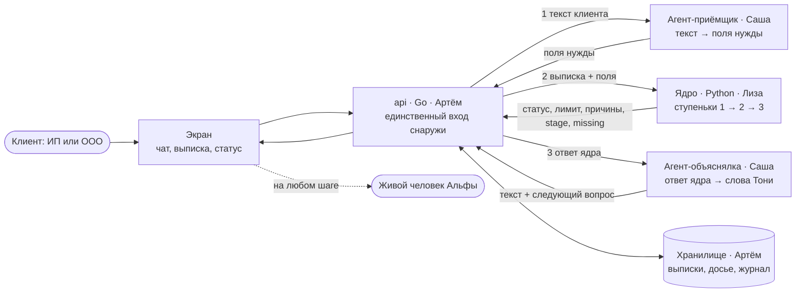
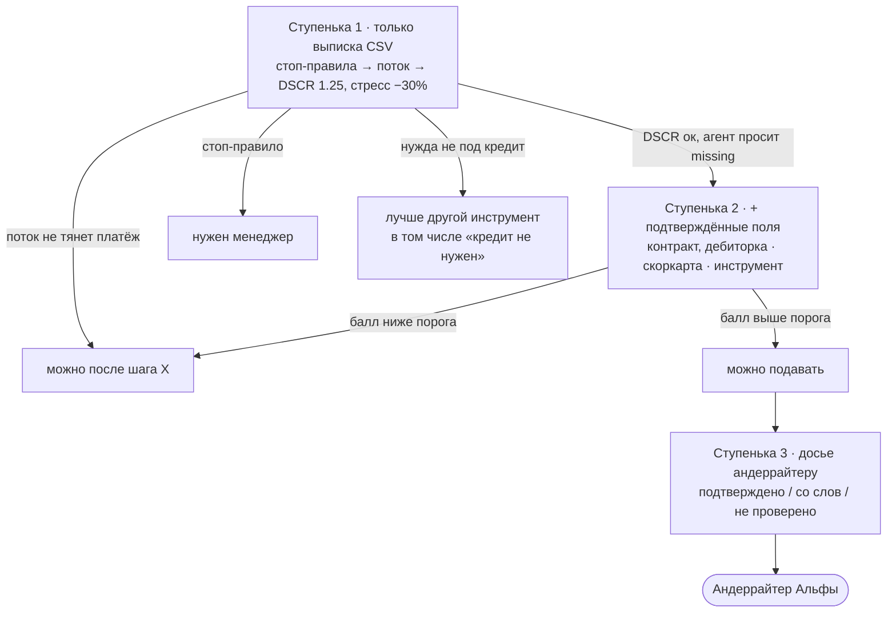
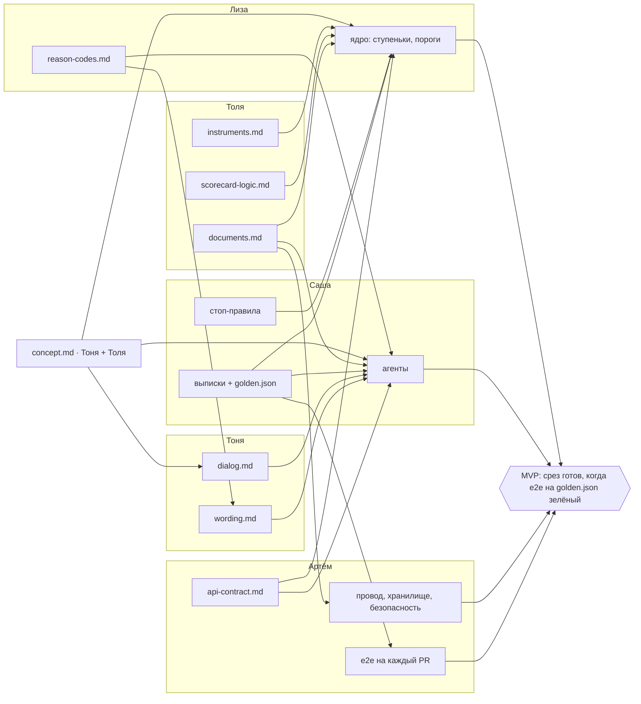
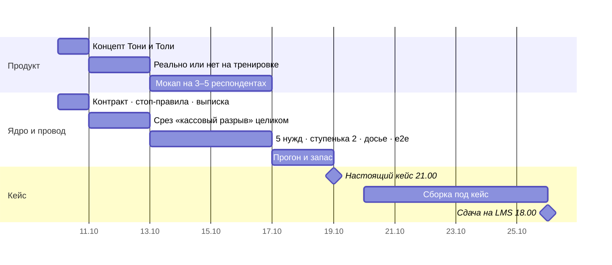

# ВЕСЬ КОНТЕКСТ ПРОЕКТА · для чат-нейронок

Как пользоваться: скопируй этот файл целиком в начало нового чата с GPT, Claude или DeepSeek
и допиши «я <имя>, моя задача в разделе hw/<имя>». Агентам (Codex, Claude Code) он не нужен:
они читают репо сами, начиная с AGENTS.md.

Файл собран 9.10 из AGENTS.md, context/core.md, context/architecture.md, context/mock-case.md и hw/*/TASK.md.
Если что-то разошлось, правда в исходниках.

---

<!-- AGENTS.md -->

# AGENTS.md — контекст для ИИ-агентов команды

Проект: хакатон Альфа-Будущее, трек «Умный кредитный кабинет предпринимателя». Команда из 5 человек.
Реальный кейс публикуют 19.10, до этого готовим оболочку и репетируем на `context/mock-case.md`.

Продукт: кредитный агент для ИП и ООО рядом с Альфа-Интеллектом. Ядро ступеньками отвечает,
нужен ли кредит, какой инструмент подходит, сколько можно сейчас и после каких проверяемых шагов;
агент (LLM) спрашивает и объясняет, решение за банком. Ядро и решения: `context/core.md`,
схема и стыки: `context/architecture.md`.

Роли: Артём: API (Go), провода, хранилище, безопасность, docker · Лиза: ядро (ступеньки, скоркарта,
пороги, коды причин) · Саша: капитан, слой агентов, контракты, золотые сценарии · Тоня: концепт,
сценарий разговора, тексты, питч · Толя: концепт, инструменты, логика скоркарты, документы, финмодель.

Правила для агента:
- сначала читай `context/`, потом делай
- идеи и решения пишет человек, агент делает рутину. Не генерируй «3 идеи» за человека
- у каждого сервиса в `docker-compose.yml` есть `mem_limit`, в сумме до 600M
- работай в ветке `<имя>/<задача>` (например `tolya/banks`), в main только через PR; своё кладёшь в `hw/<имя>/`
- замечания по твоей работе лежат в `hw/<имя>/REVIEW.md`: поправил пункт — `[x]` и строка ниже, что сделал
- конфиденциальные материалы (чужие презентации, данные финалов) в репо не кладём

---

<!-- context/core.md -->

# Ядро — «готовность к кредиту» · черновик 6.10 (из ответов Саши, до демо 8.10)

Агент делает работу клиентского менеджера на шагах 1–3 для тех, до кого менеджер не доходит,
и отдаёт андеррайтеру готовое досье вместо сырой заявки. Решение о кредите принимает банк, не агент.

## Кто что делает

| Слой | Что делает | Чего не делает |
|---|---|---|
| LLM | разбирает текст клиента в поля (сумма, цель, срок, контекст), классифицирует запрос по базе кейсов, переводит ответ ядра на человеческий | не считает, не решает, не придумывает цифры |
| Ядро (правила + модель) | подбор инструмента, лимит сейчас / после, сценарии лучший / худший, окупаемость | не разговаривает |
| Человек (менеджер, андеррайтер) | решение, залог, нестандарт | не распаковывает нужду с нуля |

## Цепочка

1. **Распаковка нужды.** Агент собирает контекст: сколько, на что, когда, из чего вернёт.
   Сверяет слова клиента с данными (выписка по счёту, отчётность). Расхождение — уточняющий вопрос, а не отказ.
   Отдельно спрашивает то, чего нет в данных: сезонность, разовый контракт, непредвиденное.
2. **Подбор инструмента.** Нужда → инструмент по таблице `hw/tolya/instruments.md`
   (разрыв → овердрафт, оборудование → лизинг, под контракт → линия / гарантия, нет залога → зонтичное поручительство).
3. **Прикидка.** Лимит сейчас и после 1–3 проверяемых действий; сценарии лучший / худший;
   окупаемость: при этой ставке и сроке вернёт ли бизнес деньги из своего потока (НГ4 Толи: «окупится ли» важнее «одобрят ли»).
4. **Досье андеррайтеру.** Нужда, инструмент, цифры, что подтверждено документом, что со слов клиента, что не проверено.
5. **Тёплая передача человеку** — всегда доступна, на любом шаге.

## Кто → что отдаёт → кому — черновик капитана, зоны делим вместе на созвоне 8.10

| Шаг | Владелец | Отдаёт | Кому |
|---|---|---|---|
| 1. Распаковка нужды | Тоня + Толя | 5 типовых нужд с формулировками клиентов из интервью | Саше (промпт агента) |
| 2. Инструменты и риски | Толя + Тоня | таблица «нужда → инструмент → условия → ставка» + риски каждого инструмента по классам | Лизе (параметры дерева), Артёму (правила) |
| 3. Дерево решений и прикидка | Лиза | дерево: параметры (DSCR, стабильность оборота, залог, срок…) → развилки → лист «инструмент + статус»; скоркарта даёт лимит и коды причин | Артёму (JSON по контракту) |
| 4. Досье и API | Артём | ответ по `api-contract.md` | Тоне (экраны), андеррайтеру (досье) |
| 5. Экран и питч | Тоня | как ответ видит клиент и жюри | команде |
| Ядро, промпт, стыки | Саша | этот файл | всем |

Дерево экспертное, из правил и рисков, не обученное: данных на обучение нет, и прозрачность — плюс для андеррайтера.

## Принято 7.10

- база кейсов — 5 типовых нужд: кассовый разрыв, закупка под контракт, оборудование, сезон, рост; из интервью и ресёрча, сверх не выдумываем
- в прототипе только выписка по счёту CSV (дата, сумма, контрагент, назначение); PDF — после 19.10, если кейс потребует
- окупаемость — DSCR (свободный поток / платёж, порог 1.25) + стресс худшего сценария; ставка — с сайта Альфы через таблицу Толи; другие метрики посмотреть
- статусы: «можно подавать» · «можно после шага X» · «лучше другой инструмент» · «нужен менеджер»; слова «одобрено» нет, решение за банком
- что с этого Альфе: меньше часов андеррайтера на мелкую заявку, меньше заявок теряется в «перезвоним»; метрика совета — доля досье, которые андеррайтер не вернул на доуточнение
- ИП внутри, физлица снаружи
- вопросы агента: 1) «на что» 2) «когда и из чего вернёшь» — срок агент выводит из ответа; источник сверяется с выпиской: «подтверждено / со слов / не проверено», DSCR считается только на подтверждённом

## Открыто

- [ ] мультиагентный спор поверх ядра (идея Саши 7.10) — после 8.10, см. ниже
- [ ] 9.10: вместо спора в прототип предлагаются ступеньки с передачей мяча: агент → ядро → агент, схема в `context/architecture.md`. Решаем на тренировке 11.10, спор агентов тогда уходит в «что дальше»

## Как передаём задачи (9.10, чтобы не повторить 7.10)

1. Задача рождается из концепта или ядра. У каждой есть «зачем»: какую функцию концепта или ступеньку ядра она двигает. Нет «зачем», нет задачи.
2. У каждой задачи есть вход (что и от кого ждёшь) и выход (какой файл и кому отдаёшь). Так видно, кто кого ждёт и где кончается чья зона.
3. Список задач живёт в `hw/<имя>/TASK.md`. Пуш в main сам перерисовывает доску в тг и пишет в топик задач, что добавилось и что закрылось, поэтому в чате список не дублируем.
4. Готово, когда получатель написал в тг «могу использовать», а не когда автор доделал. Галочку ставит Саша (или ты сам, если правишь репо).
5. Застрял больше дня: пишешь в топик задач, кого ждёшь. Вечерний чекин в 21:00 спрашивает и так.
6. Новая рамка продукта или новый набор задач: только после общего созвона, на котором прозвучало «зачем».

## Решено капитаном 7.10 — по умолчанию, оспорить можно на созвоне 8.10

- **Модель.** Признаки только из выписки: оборот, его стабильность, доля крупнейшего клиента, платежи по уже взятым кредитам, минимальный остаток. Скоркарта экспертная: баллы и интервалы ставит Толя, код пишет Лиза, AUC не заявляем. Polish / GMSC в продукт не идут. Лиза дополнительно держит пайплайн, который переобучит модель на данных оргов 19.10 за час
- **Лимит.** Максимальный платёж = подтверждённый месячный поток / 1.25 → лимит = аннуитет на этот платёж при ставке и сроке
- **Инвестиционные нужды** (оборудование, рост). DSCR на текущем потоке + отдельной строкой «окупаемость со слов клиента», с пометкой; если не проходит — статус «можно после шага: подтвердить контракт / смету»
- **Ставка.** Верх диапазона с сайта Альфы; если указано только «от X%» — X + 3 п.п. Оптимистичную ставку не берём
- **Порядок слоёв.** Стоп-правила → DSCR → скоркарта → подбор инструмента. Спорят два слоя — побеждает строгий
- **Сверка «из чего вернёшь».** По ИНН контрагента в выписке (в синтетике ИНН есть всегда); нет ИНН — по названию + уточняющий вопрос клиенту
- **Без ключа LLM.** Шаг 1 — кнопки 5 типовых нужд + поля «сумма», «когда и из чего вернёшь»; остальное ядро то же
- **Сегмент.** ИП и ООО внутри, физлица и самозанятые снаружи
- **API.** Без состояния: клиент в каждом запросе шлёт всю историю диалога. Контракт — `context/api-contract.md`, владелец Артём; в него добавляются 4 статуса выше, досье (подтверждено / со слов / не проверено) и следующий вопрос агента
- **Коды причин.** Один общий список `context/reason-codes.md`: коды ведёт Лиза, Тоня к тем же кодам пишет формулировки для клиента
- **Метрика в прототипе.** Андеррайтера нет, поэтому прокси — доля полей досье с пометкой «подтверждено»
- **Синтетические выписки.** Генератор на 5 типовых нужд по 12 месяцев — Саша, до тренировки 11.10
- **Таски.** Источник правды — этот файл + `hw/<имя>/TASK.md`; старые наборы в `case-champion/docs/` — архив, не читать

## На созвон 8.10 — решить вместе

К созвону каждый изучает пробный кейс (`context/mock-case.md`, `context/case-brief/`) и делает любой ресёрч, какой захочет. На звонке — мысли, идеи, потом вместе делим зоны.

1. Лиза: одна задача (скоркарта + пайплайн переобучения) вместо трёх — ок ли ей
2. Каталог проверяемых действий, меняющих лимит («переведи выручку», «закрой старый долг», «принеси контракт») — мозгоштурм, владельцы Толя + Тоня
3. Вход: агент ждёт запроса клиента или сам замечает разрыв в выписке — одна архитектура на тренировку
4. Процесс: чужой PR вливает не автор; 20 минут гитхаба для тех, кто сдаёт docx / xlsx
5. После созвона — переписать TASK.md всех по таблице «кто → что → кому»

---

<!-- context/architecture.md -->

# Архитектура MVP · черновик 9.10 к тренировке 11.10

Как продукт работает внутри, кто что строит и как это собирается в один прототип. Решения по ядру живут в `context/core.md`, здесь только схема и стыки. Диаграммы в Mermaid: на GitHub рисуются сами, в VS Code через превью (Ctrl+Shift+V).

## 1. Как работает: агент → ядро → агент

| Сервис | Владелец | Делает | Граница |
|---|---|---|---|
| frontend | решаем 11.10, экраны по сценарию Тони | чат, загрузка выписки, карточка статуса | показывает, не считает |
| api (Go) | Артём | вход снаружи, порядок вызовов агент → ядро → агент, хранилище, маскирование ИНН и ФИО | считает только время ответа |
| agent (Python) | Саша | разбор текста в поля нужды, объяснение ответа ядра, следующий вопрос | все цифры берёт из ответа ядра |
| ml-model = ядро (Python) | Лиза | стоп-правила, DSCR, скоркарта, пороги ступенек, инструмент | отвечает JSON, разговаривает агент |
| хранилище | Артём | выписки, досье, журнал решений | диалог едет в запросе (API без состояния, решение 7.10) |

Память всех сервисов вместе до 600M. Без ключа LLM агент работает на шаблонах Тони, путь тот же.

## 2. Ступеньки и передача мяча

Куда клиент идёт дальше, решает ядро: в каждом ответе есть `stage`, `status` и `missing`. Агент только спрашивает то, что в `missing`, и объясняет статус.

Ядро одно, ступеньки отличаются тем, сколько данных у него есть. Пороги ставит Лиза по интервалам Толи.

## 3. Кто что отдаёт и куда это встаёт

## 4. Как это сшивается в MVP

1. **Контракт раньше кода.** `api-contract.md` и `reason-codes.md` фиксируем к тренировке 11.10. Дальше каждый пишет свой кусок под контракт, а не под соседа.
2. **Скелет из заглушек.** Каждый сервис сначала отвечает по контракту фиксированными числами, и путь из конца в конец работает в первый же день тренировки.
3. **Золотые сценарии.** 5 синтетических выписок (по одной на нужду) и ожидаемые статус, инструмент и вилка лимита в `data/golden.json`. Это общий экзамен для всех кусков.
4. **Замена по одной.** Заглушки меняются на настоящее по одной; после каждой замены e2e на золотых сценариях остаётся зелёным.
5. **Готово** = e2e зелёный и получатель написал «могу использовать» (правила передачи: `context/core.md`, «Как передаём задачи»).
6. **19.10, переразметка.** Кейс может поменять вход (данные), ступеньки (пороги, метрики) или слова. Меняем слот, а не всю конструкцию.

## 5. Календарь

## 6. Открыто

- стоп-правила ступеньки 1 (Саша, к 11.10)
- `api-contract.md` и `reason-codes.md` (Артём и Лиза)
- ответ оргов: можно ли нести заготовки, сделанные до 19.10, и звать внешние LLM по API
- кто собирает фронт
- проверка на людях до кода: мокап или «агент», за которым сидит человек, на 3–5 респондентах из кастдева (13–16.10)

---

<!-- context/mock-case.md -->

# Пробный кейс · «Персонализация кредитных предложений для малого бизнеса»

Версия 2 от 7.10.2026, черновик до демо 8.10. Первая версия («шанс одобрения + 3 фактора») лежит в истории git.
Кейс написан так, как его, по нашим данным, напишут организаторы 19.10: легенда, проблема, пользователь, задача,
состав сдачи, критерии, данные и ограничения. Помимо этого в нём есть то, чего организаторы не напишут, а именно
рамки, которые нужно нарушить. Их разбор вынесен в отдельный раздел в конце, и каждая закреплена за одним человеком.

Тренировка: **сб 11.10 10:00 → вс 12.10 10:00, 24 часа без перерыва, опоздание со сдачей = ноль.**
На 12-м часу организатор (капитан) вбрасывает изменение условий, о котором заранее никто не знает.

Пометки в тексте: **[факт]** — сверено руками по первоисточнику; **[DR]** — взято из отчёта дипресерча, первоисточник не открыт;
**[кастдев]** — из наших интервью; **[гипотеза]** — наше предположение, которое тренировка должна подтвердить или убить.

---

## 1. Легенда

5 октября 2026 года Альфа-Банк запустил «Альфа-Интеллект», единого ИИ-помощника для частных клиентов и бизнеса,
который собирает в одну сводку платежи, доходы, выписки и контрагентов и предлагает предпринимателю агентов
в ролях юриста, бухгалтера и маркетолога **[факт: Ведомости, BFM, 5.10]**. Кредитного агента среди них нет, и в описаниях
запуска кредиты не упоминаются вовсе, хотя именно в кредитовании малого бизнеса банк сильнее всего среди частных игроков:
по итогам 2024 года на него пришлось 26% выдач частных банков под зонтичное поручительство Корпорации МСП, около 15,4 тыс.
договоров на сумму порядка 107 млрд ₽ **[DR: пресс-релизы Корпорации МСП и Ведомостей, 25.02.2025]**.

Банк при этом прямо называет себя AI-native: агенты уже закрывают 93% операций валютного контроля с точностью выше 95%,
а риски агентной архитектуры обсуждаются публично **[факт: Коммерсантъ № 8689448]**. Для крупного бизнеса работает
ИИ-платформа кредитования, которая оценивает заёмщика в 10 раз быстрее прежнего, но решение по-прежнему принимает
человек **[DR: alfabank.ru, не открыт]**. Руководитель направления кредитования МСБ описывает рынок как «конкуренцию
за качественных заёмщиков» **[факт: Бизнес-Онлайн, интервью М. Поляковой]**, а в интернет-банке «Альфа-Бизнес» идёт пилот
персонализации, где профиль «предприниматель» выбирают в четыре раза чаще профиля «бухгалтер» **[DR: alfabank.ru, не открыт]**.

Отсюда легенда задания: банк хочет, чтобы помощник предпринимателя умел говорить о деньгах в долг так же, как он уже
говорит о налогах и договорах, и чтобы разговор приводил к выдаче, которую банк не стал бы делать вслепую.

## 2. Проблема

Предприниматель с потребностью в 3 млн ₽ для банка клиент мелкий, и его путь к кредиту устроен так, что до звонка
менеджера он не видит ни вероятного исхода, ни суммы, ни того, какой инструмент ему вообще подходит: в флоу Альфы,
разобранном Толей, непрошедший автоматический скоринг получает «менеджер перезвонит» **[кастдев: hw/tolya, таблица банков]**.
Сбер с 2023 года показывает клиенту «кредитный потенциал», то есть сумму, факторы и советы **[факт: сверено 6.10]**,
поэтому «показать шанс и три фактора» само по себе уже не новость, и решение, которое на этом остановится, жюри сочтёт вторичным.

Цифры, которая измеряла бы потери банка на этом участке, у нас нет. **Добыть или честно оценить её — часть задания:**
сколько заявок МСБ на сумму до 5 млн уходит в «перезвоним», сколько из них теряется до звонка и во что банку обходится
час андеррайтера на мелкую заявку.

## 3. Пользователь

Владелец ИП или ООО, бизнесу больше года, оборот до 100 млн ₽ в год; решения о деньгах принимает сам, бухгалтера
в штате может не быть, в банковском приложении бывает каждую неделю. Самозанятых и физлиц в этой версии кейса нет;
граница ИП и физлица остаётся открытой до демо 8.10.

Что мы знаем из пяти интервью **[кастдев: раунды Толи и Тони, 6.10]**: вопрос «окупится ли» для предпринимателя
важнее вопроса «одобрят ли», а кредит не первое, о чём он думает, когда деньги нужны срочно (свои, знакомые, отсрочка
у поставщика). Чего мы не знаем: ни один из пяти не получал отказа, поэтому гипотезы о непонятном отказе и недоверии
к совету банка не проверены и на тренировке опираться на них нельзя.

## 4. Задача

Спроектировать и собрать кредитного агента, который встраивается в помощника предпринимателя и проводит клиента
от сформулированной словами нужды до готового к рассмотрению запроса:

1. распаковывает нужду (на что, сколько, когда и из чего вернутся деньги) и сверяет слова клиента с его выпиской,
   так что расхождение порождает уточняющий вопрос, а не отказ;
2. подбирает инструмент (овердрафт, кредитная линия, лизинг, гарантия, кредит под зонтичное поручительство);
3. считает лимит сейчас и после одного–трёх проверяемых действий со сроком, а также окупаемость при текущей ставке;
4. собирает для андеррайтера досье, в котором разделено подтверждённое документом, сказанное клиентом и не проверенное;
5. в любой момент передаёт клиента живому человеку вместе с этим досье.

Решение о выдаче агент не принимает и слова «одобрено» не произносит. Подробная логика ядра — `context/core.md`.

## 5. Что сдать к вс 12.10 10:00

- работающий прототип, который поднимается одной командой `docker compose up` на чистой машине; без этого,
  как и в правилах 2026 года (п. 8.2.3), решение не оценивается;
- API агента с описанным контрактом: вход — текст клиента и выписка, выход — инструмент, лимиты, действия, досье;
- демо-сценарий на три минуты, в котором агент проходит путь из раздела 4 на одном вымышленном клиенте;
- презентация до 10 слайдов: проблема в цифре, решение, демо, выгода банка, финмодель, риски, пилот;
- README, по которому посторонний человек запускает прототип за пять минут.

## 6. Как оцениваем

Веса наши: критериев 2026 года организаторы не публиковали. По двум финалам Тони жюри Альфы стабильно смотрит
на креативность, на то, выдерживает ли решение стресс-тест, на финмодель и на внешний вид **[кастдев: «Опыт прошлых лет»]**.

| Критерий | Вес |
|---|---|
| прототип работает целиком и воспроизводимо | 25 |
| польза для клиента: совет конкретен, проверяем и учитывает окупаемость | 20 |
| выгода банка посчитана: метрика, финмодель, эффект на час андеррайтера | 20 |
| решение пережило твист 12-го часа без потери работоспособности | 15 |
| нарушенная рамка (раздел 9) обоснована данными, а не вкусом | 10 |
| демо и презентация укладываются в регламент | 10 |

## 7. Данные

Данных Альфы у нас нет и до 19.10 не будет, поэтому слой данных собирается сменным, чтобы оболочка пережила любой датасет.

- **Выписка по счёту** — синтетический CSV на 12 месяцев для 3–5 типовых клиентов (сезонный, с разовым контрактом,
  с кассовым разрывом, стабильный, растущий); генератор и описание полей лежат в репо.
- **Скоринг** — открытые данные по кредитам малому бизнесу (SBA Loans, Polish bankruptcy), логистическая регрессия
  на WoE как базовая модель; GMSC из разминки Лизы описывает физлиц и в продукт не идёт.
- **Инструменты и условия** — таблица `hw/tolya/` по кредитным продуктам банков.

## 8. Ограничения

LLM разбирает текст и переводит ответ ядра на человеческий язык, но не считает и не решает; ядро работает без LLM,
а демо проходит с шаблонным fallback, поскольку тренировка идёт **без ключа LLM**. Репозиторий остаётся закрытым:
правила 2026 года (п. 4.4.2) запрещают публиковать код и модели решения. Память всех сервисов в сумме до 600M.

---

## 9. Рамки, которые нужно нарушить

Ниже ТЗ, сформулированное буквально, и гипотеза о том, где буквальное исполнение проигрывает. Гипотеза не ответ:
решает владелец, и нарушение засчитывается, только если оно обосновано цифрой или цитатой из интервью.

**Артём.** Буквально задача читается как «сделайте кабинет с экраном и API». Агент внутри «Альфа-Интеллекта», однако,
скорее инструмент, который вызывает помощник, чем отдельный сайт, и тогда главный продукт бэкенда — контракт API,
пригодный для вызова чужим агентом, а интерфейс становится лишь одним из клиентов этого контракта.

**Лиза.** Буквально нужно оценить вероятность одобрения. У предпринимателя, который впервые приходит за кредитом,
кредитной истории в данных нет, зато есть выписка, поэтому полезнее может оказаться модель, предсказывающая
кассовый разрыв и его глубину, чем модель дефолта, обученная на чужой популяции.

**Толя.** Буквально агент помогает клиенту получить кредит. Если по расчёту кредит не окупается, честный совет —
не брать его, и банк теряет выдачу, но не получает просрочку; это нужно посчитать в деньгах банка, чтобы отказ
от продажи выглядел в презентации выигрышем, а не благотворительностью.

**Тоня.** Буквально нужно показать экраны кабинета. Сильнее может сработать демо, в котором экрана почти нет:
три минуты диалога, где агент первым замечает разрыв в выписке и сам приходит к клиенту, а жюри видит
разговор, а не форму.

**Саша.** Буквально клиент приходит с запросом. Если агент видит разрыв раньше клиента, досье андеррайтеру
собирается до заявки, и метрика сдвигается с «скорость ответа» на «доля выдач, подготовленных заранее».

## 10. Твист 12-го часа

Содержание вброса знает только капитан. Он меняет условия так, что часть уже посчитанного устаревает,
и команда должна за час пересобрать расчёт, не уронив прототип.

## После тренировки

Разбор на 30 минут: где застряли, кто кого ждал, что не собралось, какая рамка сломалась и что это дало.
Выводы становятся правилами команды до 19.10.

---

<!-- hw/artem/TASK.md -->

# Артём · провод, хранилище, безопасность · до пт 16.10

Делай сверху вниз: не успеваешь всё, нижнее ждёт, верхнее нет. Непонятно, пиши Саше в личку, отвечу в тот же день.
Где твой кусок в продукте: `context/architecture.md`. Как передаём задачи: `context/core.md`, раздел «Как передаём задачи».
Твоему агенту, как раньше: `hw/artem/AGENT.md`.

**Что поменялось 9.10.** Всё, что про деньги, считает ядро Лизы (Python). Агент Саши (LLM) разговаривает. Ты держишь всё между ними: вход снаружи, провода, хранилище, безопасность, запуск одной командой. Ступеньки в Go считать не надо.

---

## 1. Контракт и провод

_главное, к тренировке 11.10_

- [ ] `context/api-contract.md` вместе с Лизой и Сашей: запрос (выписка CSV, нужда, сумма, история диалога) и ответ (`decision_id`, `model_version`, `stage`, `status` из 4, `limit_rub.now / after_actions`, `reasons`, `missing`, `instrument`, `dossier`, `next_question`, `human_review_available`)
- [ ] api проксирует POST в ml-model по `ML_URL` с таймаутом; ml-model упала → 502 с текстом, а не зависание
- [ ] ml-model не торчит наружу: убрать `5000:5000`, добавить `depends_on`

**Зачем.** Сейчас `/score` отдаёт хардкод `score: 0` и в модель не ходит. Пока провода нет, ядро, агент и экран не собираются в одно.
**Вход:** 4 статуса и формат досье из `context/core.md` (раздел «Принято 7.10»).
**Выход:** контракт → Лизе, Саше, Тоне; провод → всем.
**Готово, когда:** `curl -X POST localhost:8080/score` с выпиской отвечает JSON из питона, а после `docker compose stop ml-model` отвечает 502.

## 2. Хранилище

- [ ] выбрать: SQLite внутри api или Postgres отдельным сервисом. Память всех сервисов вместе до 600M, сейчас занято 512M, поэтому Postgres только если ужмём ml-model или поднимем сервер
- [ ] хранить: выписку по `decision_id`, досье, журнал решений (`decision_id`, `model_version`, вход, ответ)
- [ ] `GET /dossier/{id}`: досье для андеррайтера и для экрана «на каком я этапе»

**Зачем.** Досье андеррайтеру и «на каком я этапе» вместо «менеджер перезвонит» (идеи 10 и 11 с созвона) требуют, чтобы ответ где-то жил. По журналу покажем жюри, почему ядро ответило именно так.
Диалог по-прежнему едет в запросе целиком (решение 7.10: API без состояния), в базе только выписки, досье и журнал.
**Вход:** размеры данных от Лизы, таблица документов Толи `hw/tolya/documents.md`.
**Готово, когда:** досье открывается по id после `docker compose restart`.

## 3. Безопасность

- [ ] наружу смотрят только api и фронт; ключи только в `.env`, его нет в репо
- [ ] в LLM уходят поля нужды и ответ ядра, а не сырая выписка: ИНН, ФИО и названия контрагентов маскируются до вызова агента
- [ ] после 19.10 сайт под паролем: данные кейса конфиденциальны (п. 4.4.1 правил)

**Зачем.** Выписка: банковская тайна и чужие персональные данные. Жюри из банка первым делом спросит, куда уходят данные клиента.
**Готово, когда:** поиск ИНН из тестовой выписки по логам сервиса агента ничего не находит.

## 4. Сборка и проверка на каждый PR

- [ ] сервис `agent` (Саша) в `docker-compose.yml`: `LLM_API_KEY` из `.env`, без ключа работает на шаблонах; `mem_limit` у всех
- [ ] e2e: скрипт гонит выписки из `data/synthetic/` через api и сверяет статусы с `data/golden.json`; в Actions на каждый PR

**Зачем.** Главный критерий жюри: прототип работает (п. 8.2.3). Золотые сценарии сразу ловят, если чей-то кусок сломал общий путь, а не на демо.
**Вход:** выписки и `golden.json` от Саши.
**Готово, когда:** PR, который ломает статус хотя бы одного сценария, становится красным.

## 5. Ресёрч: откуда банк берёт данные (вечер)

- [ ] `hw/artem/data-sources.md`: таблица «источник → что даёт → как подключиться (API, авторизация, формат) → в прототипе заглушка или «что дальше»»
- [ ] проверить: выписки из других банков (как у Точки), MCP Т-Бизнеса и Sber API выписок (ссылки в анализе банков Толи), ФНС и ЕГРЮЛ по ИНН, бухгалтерия (1С, Контур), кредитная история (БКИ), открытые API ЦБ

**Зачем.** Ступенька 2 «подтверди без бумажки» живёт на этих источниках. Заодно это слайд «что дальше» для Альфы.
**Выход:** → Саше (что агент может подтянуть сам), Тоне (слайд).

---

Снято 9.10: идеи в `ideas.md`, чтение ресёрча и свой дипресерч (ресёрч теперь пункт 5). Проверка запуска частично уже есть: деплой из main проверяет `/api/health` на сервере, пункт 4 добавляет проверку на каждый PR.

---

<!-- hw/liza/TASK.md -->

# Лиза · ядро ступеньками · до пт 16.10

Делай сверху вниз: не успеваешь всё, нижнее ждёт, верхнее нет. Непонятно, пиши Саше в личку, отвечу в тот же день.
Где твой кусок в продукте: `context/architecture.md`. Как передаём задачи: `context/core.md`, раздел «Как передаём задачи».

**Что поменялось 9.10.** Ядро отвечает ступеньками: сначала быстро по одной выписке, дальше агент просит ровно те данные, которые нужны следующей ступеньке, полный пакет документов только в конце (идея с созвона 8.10 про пороги).
Ядро одно, ступеньки отличаются тем, сколько данных у него есть. Три разные модели не обучаем: меток дефолта нет.
Куда передать клиента дальше, решает ядро, агент Саши это только озвучивает. Поэтому пороги ступенек твои.

---

## 1. Ступенька 1 по выписке

_главное, к тренировке 11.10_

- [ ] поток из выписки CSV: поступления и обязательные списания по месяцам, подтверждённый месячный поток
- [ ] DSCR: максимальный платёж = поток / 1.25, лимит сейчас = аннуитет на этот платёж при ставке и сроке; стресс: выручка −30%
- [ ] ответ ступеньки по `context/api-contract.md`: статус, лимит сейчас, коды причин, `missing` (каких данных не хватает для ступеньки 2)

**Зачем.** Это скелет: на него садятся агент Саши, провод Артёма и экран. Без него собирать нечего.
**Вход:** выписка «кассовый разрыв» и стоп-правила от Саши (к тренировке), формулы из `context/core.md`.
**Выход:** функция в `services/ml-model` → Артёму (провод) и Саше (агент).
**Готово, когда:** выписка «кассовый разрыв» даёт тот статус, что записан в золотых сценариях Саши (`data/golden.json`).

## 2. Ступенька 2: скоркарта и пороги

- [ ] скоркарта на признаках из выписки: оборот, его стабильность, доля крупнейшего клиента, платежи по уже взятым кредитам, минимальный остаток
- [ ] интервалы и баллы: из `hw/tolya/scorecard-logic.md` (Толя), код твой, AUC не заявляем
- [ ] пороги перехода: какой балл ведёт к «можно подавать» (дальше досье), какой к «можно после шага X», какой к «нужен менеджер»
- [ ] подтверждённые поля второй ступеньки (контракт, дебиторка) пересчитывают поток и дают «лимит после шага»

**Зачем.** Это и есть пороги, на которых агент передаёт мяч дальше. Интервалы ставит финансист, а не алгоритм, поэтому андеррайтер может проверить логику.
**Вход:** интервалы Толи; его таблица документов `hw/tolya/documents.md`: что какой документ подтверждает.
**Выход:** тот же контракт, поле `stage` = 2 → Артёму и Саше.
**Готово, когда:** на 5 золотых сценариях статусы совпадают с ожидаемыми.

## 3. Коды причин

- [ ] `context/reason-codes.md`: общий список кодов (`DSCR_LOW`, `REVENUE_UNSTABLE`, …), у каждого: можно изменить или нет и какое проверяемое действие его снимает

**Зачем.** Из кодов агент объясняет отказ, а Тоня пишет к ним слова для клиента. Список один на всех, чтобы никто не придумывал свои.
**Выход:** → Тоне (тексты), Саше (агент), Артёму (контракт).
**Готово, когда:** Тоня написала, что по списку можно писать тексты.

## 4. Размеры данных для Артёма (20 минут)

- [ ] сколько строк и килобайт в выписке за 12 месяцев, что хранить сырым, что признаками, сколько весит ответ ядра

**Зачем.** Артём выбирает хранилище и должен уложиться в память сервера: все сервисы вместе до 600M.
**Выход:** 5 строк в `hw/liza/CONTEXT.md` → Артёму.

## 5. Пересчёт за вечер 19.10 (после 13.10)

- [ ] один скрипт: данные оргов → те же признаки → пересчёт интервалов и порогов → новая `model_version`

**Зачем.** 19.10 в 21:00 дадут настоящий кейс. Если там будут данные, ядро должно переехать на них за вечер, а не за три дня.

---

Снято 9.10: Polish и SBA в продукт не идут (решение 7.10: признаки только из выписки), ноутбук из PR #19 остаётся разминкой. SHAP не нужен: причины берём из баллов скоркарты. Чтение ресёрча и свой дипресерч переносим на после 19.10.

---

<!-- hw/tonya/TASK.md -->

# Тоня · концепт и как агент говорит · до пт 16.10

Делай сверху вниз: не успеваешь всё, нижнее ждёт, верхнее нет. Непонятно, пиши Саше в личку, отвечу в тот же день.
Где твой кусок в продукте: `context/architecture.md`. Как передаём задачи: `context/core.md`, раздел «Как передаём задачи».

**Что поменялось 9.10.** Кастдев Толи: кредит берут под конкретную задачу и сначала думают «окупится ли», а первыми тратят свои деньги. Агент ведёт клиента ступеньками: сначала быстрый ответ по выписке, дальше просит ровно то, что нужно следующему шагу, полный пакет документов только в конце (идея с созвона 8.10).

---

## 1. Концепт вместе с Толей

_главное, сб 10.10_

- [ ] `context/concept.md`: функции продукта своими словами и как они связаны; что из 20 идей идёт в прототип, что в мокап, что в «что дальше»

**Зачем.** Договорились 8.10: сначала концепт, потом технари говорят «реально / нет», потом задачи. Без концепта непонятно, под какие сценарии строить ступеньки ядра.
**Вход:** саммари созвона 8.10, кастдев и анализ банков Толи, твои интервью.
**Выход:** → Лизе, Артёму, Саше: «реально / нет» на тренировке 11.10.
**Готово, когда:** файл в main, и на тренировке его прошли вслух.

## После концепта (не начинать до тренировки)

- `hw/tonya/dialog.md`: сценарий разговора по ступенькам. Предприниматель пишет «дадут мне 3 млн на закупку?», и дальше по шагам: что агент спрашивает, где показывает цифры, где просит следующий документ и объясняет зачем, где предлагает другой инструмент или говорит «кредит не нужен», где кнопка «поговорить с человеком». Это наш экран словами: по нему Саша собирает агента, а ты потом демо для питча
- `hw/tonya/wording.md`: как агент говорит в каждом из 4 статусов и к каждому коду причин Лизы (`context/reason-codes.md`). Вместо «одобрено»: «можно подавать, вот что увидит банк», вместо «отказ»: «сейчас не получится, вот почему и что изменить». Шаблоны работают и без LLM, поэтому демо не упадёт, даже если ключ кончится
- `hw/tonya/alfa-intellect.md` (30 минут): 5 строк, что Альфа-Интеллект умеет для бизнеса и куда встаёт наш агент, и 3 строки, чем мы отличаемся от «Кредитного потенциала» Сбера

---

Снято 9.10: интервью сделаны; уроки чемпионатов, чтение ресёрча и свой дипресерч переносим на после 19.10.

---

<!-- hw/tolya/TASK.md -->

# Толя · концепт, инструменты, документы · до пт 16.10

Делай сверху вниз: не успеваешь всё, нижнее ждёт, верхнее нет. Непонятно, пиши Саше в личку, отвечу в тот же день.
Где твой кусок в продукте: `context/architecture.md`. Как передаём задачи: `context/core.md`, раздел «Как передаём задачи».

**Что сделано к 9.10.** Интервью, анализ шести банков, кастдев раунд 1 с новыми гипотезами, идеи созвона в нормальном виде. Это уже поменяло продукт: НГ2 и НГ4 (кредит берут под конкретную задачу, «окупится ли» важнее «одобрят ли») и Г5 (сначала свои деньги) легли в основу ядра.

---

## 1. Концепт вместе с Тоней

_главное, сб 10.10_

- [ ] `context/concept.md`: функции продукта своими словами и как они связаны; что из 20 идей идёт в прототип, что в мокап, что в «что дальше»

**Зачем.** Договорились 8.10: сначала концепт, потом технари говорят «реально / нет», потом задачи. Без концепта непонятно, под какие сценарии строить ступеньки ядра.
**Вход:** саммари созвона 8.10, твой кастдев и анализ банков.
**Выход:** → Лизе, Артёму, Саше: «реально / нет» на тренировке 11.10.
**Готово, когда:** файл в main, и на тренировке его прошли вслух.

## 2. Таблица «нужда → инструмент»

- [ ] `hw/tolya/instruments.md`: 5 типовых нужд (кассовый разрыв, закупка под контракт, оборудование, сезон, рост) → инструмент Альфы → главные условия → ставка (верх диапазона; если только «от X%», то X + 3 п.п.) → ссылка на сайт

**Зачем.** Это буквально правила ядра: без таблицы агент не может сказать «лучше другой инструмент».
**Выход:** → Лизе (подбор в ядре), Артёму (справочник в базе).
**Готово, когда:** у каждой из 5 нужд есть строка со ссылкой на сайт Альфы.

## 3. Документы по ступенькам

- [ ] `hw/tolya/documents.md`: какие документы есть у ИП на УСН, ООО на УСН, ООО на ОСНО; на какой ступеньке банк их просит; формат (CSV, PDF, выгрузка 1С, xlsx); примерный объём (страниц, строк, мегабайт); что каждый подтверждает из ответа на «когда и из чего вернёшь»

**Зачем.** Ступеньки просят документы не все сразу, а по одному, и каждый должен что-то подтверждать. По таблице Лиза поймёт, какие поля брать, Артём поймёт, сколько места и как хранить, а агент будет знать, что просить следующим.
В прототипе документы не разбираем (решение 7.10: на входе только выписка CSV), на второй ступеньке клиент вводит поля руками. Таблица нужна, чтобы это было правдоподобно, и к 19.10, если кейс попросит документы.
**Выход:** → Лизе (поля), Артёму (объёмы), Саше (вопросы агента).
**Готово, когда:** Лиза и Артём написали, что понимают, что с этим делать.

## После концепта (не начинать до тренировки)

- `hw/tolya/scorecard-logic.md` вместе с Лизой: 5–8 признаков из выписки, на какие интервалы резать, в какую сторону тянет риск и почему. Созвон с ней на 20 минут
- `hw/tolya/finmodel.md`: заработок Альфы на одном дополнительном клиенте МСБ в трёх сценариях; допущения списком, у каждого источник или пометка «допущение». На питче блок «что с этого банку» пока пустой

---

Снято 9.10: интервью и анализ конкурентов сделаны; чтение ресёрча и свой дипресерч переносим на после 19.10.

---

<!-- hw/sasha/TASK.md -->

# Саша · агенты, стыки, золотые сценарии · до пт 16.10

Как устроен продукт целиком: `context/architecture.md`. Мой кусок: слой агентов и всё, по чему собирается MVP, то есть контракты и золотые сценарии.

---

## 1. Разблокировать команду

_к тренировке 11.10_

- [ ] стоп-правила и пороги ступеньки 1 в `context/core.md`: Лизе в ядро, Артёму в контракт
- [ ] генератор синтетических выписок: к тренировке одна нужда «кассовый разрыв», остальные 4 до 15.10 → `data/synthetic/`
- [ ] золотые сценарии `data/golden.json`: на каждую выписку ожидаемые статус, инструмент и вилка лимита
- [ ] вопрос оргам: можно ли приносить заготовки кода, сделанные до 19.10, и звать внешние LLM по API

**Зачем.** По золотым сценариям собирается всё: Лиза проверяет ядро, Артём гоняет e2e, я агента. Без них «готово» у каждого своё. От ответа оргов зависит, можно ли вообще нести скелет на 19.10.

## 2. Слой агентов

- [ ] агент-приёмщик: текст клиента → поля нужды (на что, сколько, когда и из чего вернёт); только разбор, своих цифр не пишет
- [ ] передача мяча: по ответу ядра (`stage`, `status`, `missing`) агент выбирает следующий вопрос; сам ступеньку не выбирает
- [ ] агент-объяснялка: ответ ядра → текст по словарю Тони; цифры только из ответа ядра; без ключа работают шаблоны
- [ ] разработка на подписке, в прототипе ключ API в `.env`: жюри запускает без меня

## 3. Капитан

- [ ] тренировка 11–12.10: «реально / нет» по концепту; срез «кассовый разрыв» собран из конца в конец
- [ ] после тренировки: пункты «после концепта» у Тони и Толи переписать в задачи с галочками
- [ ] фронт: решить на тренировке, кто собирает (чат, загрузка выписки, карточка статуса по сценарию Тони)
- [ ] PR #19 Лизы: влить как разминку или закрыть
- [ ] 19.10 21:00 кейс: переразметка, что из нашего переиспользуем, что меняем

---

Снято 9.10: PR тасков v2 и деплоя влиты, секреты доски заданы, ядро на бумаге в `core.md`, граница «ИП / физлица» решена 7.10. Свой дипресерч, дифф с ChatGPT, разведка участников 2025 и `mock-case.md` под новое ядро переносятся на после 19.10.
