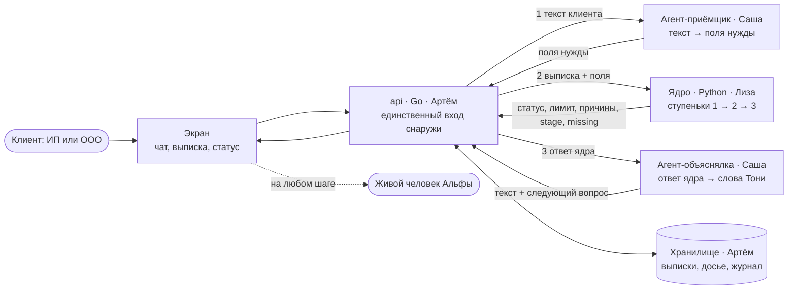
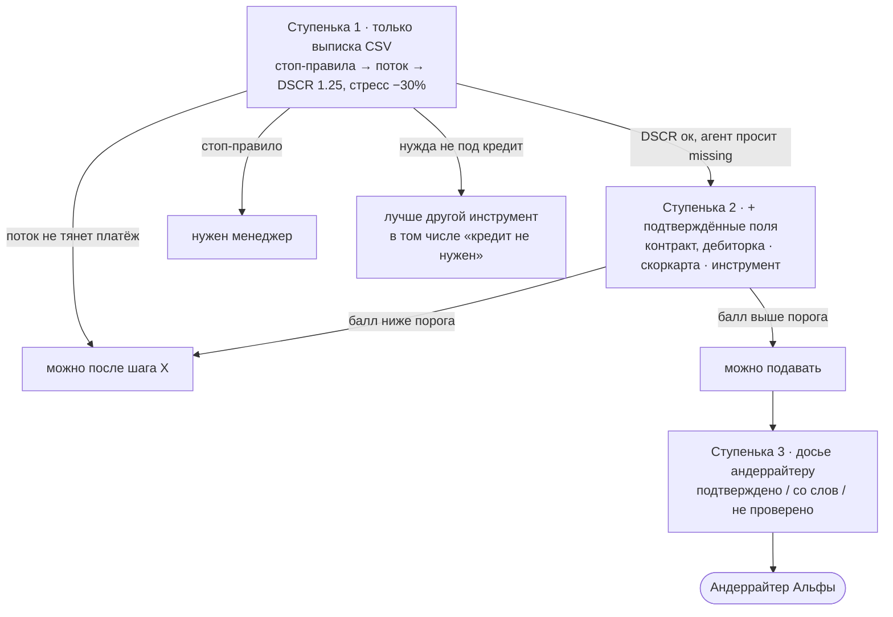
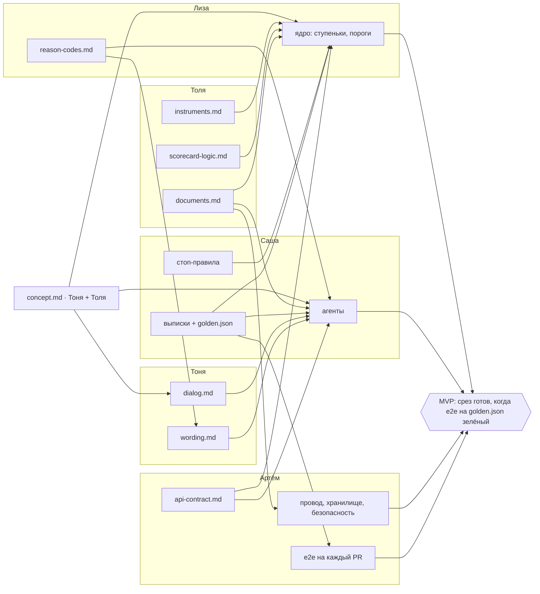
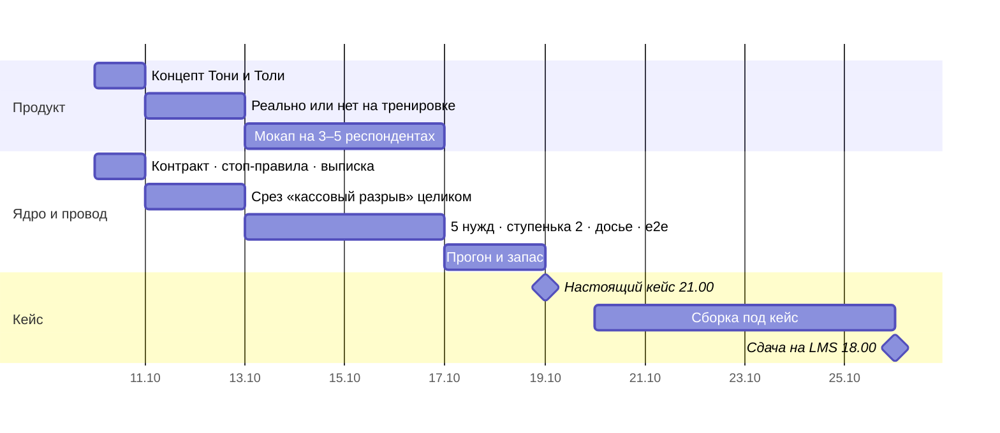

# Архитектура MVP · черновик 9.10 к тренировке 11.10

Как продукт работает внутри, кто что строит и как это собирается в один прототип. Решения по ядру живут в `context/core.md`, здесь только схема и стыки. Диаграммы в Mermaid: на GitHub рисуются сами, в VS Code через превью (Ctrl+Shift+V).

## 1. Как работает: агент → ядро → агент

| Сервис | Владелец | Делает | Граница |
|---|---|---|---|
| frontend | решаем 11.10, экраны по сценарию Тони | чат, загрузка выписки, карточка статуса | показывает, не считает |
| api (Go) | Артём | вход снаружи, порядок вызовов агент → ядро → агент, хранилище, маскирование ИНН и ФИО | считает только время ответа |
| agent (Python) | Саша | разбор текста в поля нужды, объяснение ответа ядра, следующий вопрос | все цифры берёт из ответа ядра |
| ml-model = ядро (Python) | Лиза | стоп-правила, DSCR, скоркарта, пороги ступенек, инструмент | отвечает JSON, разговаривает агент |
| хранилище | Артём | выписки, досье, журнал решений | диалог едет в запросе (API без состояния, решение 7.10) |

Память всех сервисов вместе до 600M. Без ключа LLM агент работает на шаблонах Тони, путь тот же.

## 2. Ступеньки и передача мяча

Куда клиент идёт дальше, решает ядро: в каждом ответе есть `stage`, `status` и `missing`. Агент только спрашивает то, что в `missing`, и объясняет статус.

Ядро одно, ступеньки отличаются тем, сколько данных у него есть. Пороги ставит Лиза по интервалам Толи.

## 3. Кто что отдаёт и куда это встаёт

## 4. Как это сшивается в MVP

1. **Контракт раньше кода.** `api-contract.md` и `reason-codes.md` фиксируем к тренировке 11.10. Дальше каждый пишет свой кусок под контракт, а не под соседа.
2. **Скелет из заглушек.** Каждый сервис сначала отвечает по контракту фиксированными числами, и путь из конца в конец работает в первый же день тренировки.
3. **Золотые сценарии.** 5 синтетических выписок (по одной на нужду) и ожидаемые статус, инструмент и вилка лимита в `data/golden.json`. Это общий экзамен для всех кусков.
4. **Замена по одной.** Заглушки меняются на настоящее по одной; после каждой замены e2e на золотых сценариях остаётся зелёным.
5. **Готово** = e2e зелёный и получатель написал «могу использовать» (правила передачи: `context/core.md`, «Как передаём задачи»).
6. **19.10, переразметка.** Кейс может поменять вход (данные), ступеньки (пороги, метрики) или слова. Меняем слот, а не всю конструкцию.

## 5. Календарь

## 6. Открыто

- стоп-правила ступеньки 1 (Саша, к 11.10)
- `api-contract.md` и `reason-codes.md` (Артём и Лиза)
- ответ оргов: можно ли нести заготовки, сделанные до 19.10, и звать внешние LLM по API
- кто собирает фронт
- проверка на людях до кода: мокап или «агент», за которым сидит человек, на 3–5 респондентах из кастдева (13–16.10)
