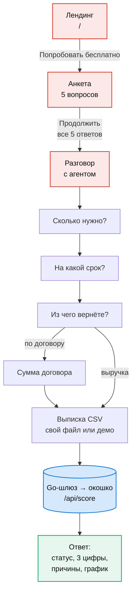
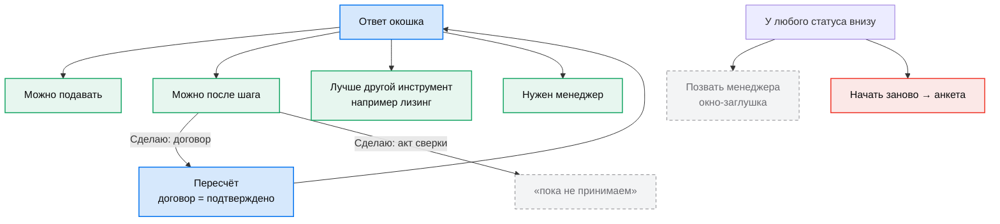
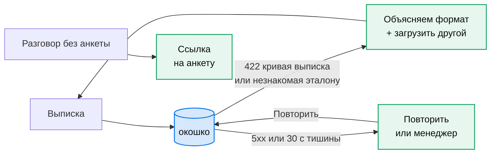
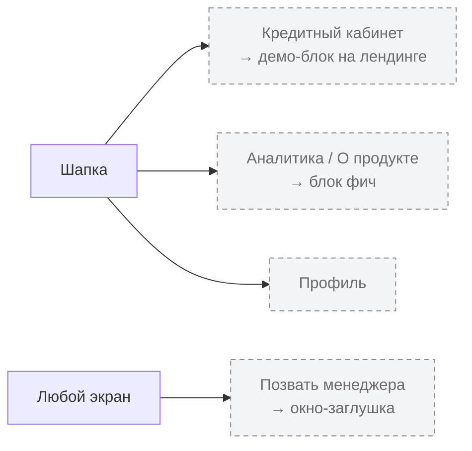

# Пути пользователя · 12.10

Рендер для команды: https://158-160-212-36.sslip.io/puti.html (страница `services/frontend/puti.html`, схемы те же).
Поменял путь на сайте: поправь схему здесь и там.

## 1 · Главный путь: от лендинга до ответа

Три экрана. Анкета Тони даёт форму бизнеса и возраст, разговор добирает сумму, срок и источник возврата, выписка подтверждает. Ответ считает окошко на сервере, сайт сам ничего не считает.

## 2 · Что бывает после ответа

Четыре статуса без слова «одобрено». У «после шага» есть кнопка «Сделаю»: договор уходит как подтверждённый, цифры пересчитываются. Остальные документы в прототипе пока не принимаем.

## 3 · Когда что-то пошло не так

Ответы человека не теряются ни в одной ветке. Важно: ядро на сервере сейчас эталон, оно считает только демо-выписки. Свой CSV получит «не получилось прочитать», пока не включим ядро Лизы.

## 4 · Тупики, которые есть сейчас

Кнопки, которые никуда не ведут. Каждая это задача или осознанное «что дальше».

