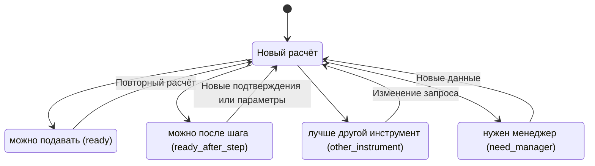
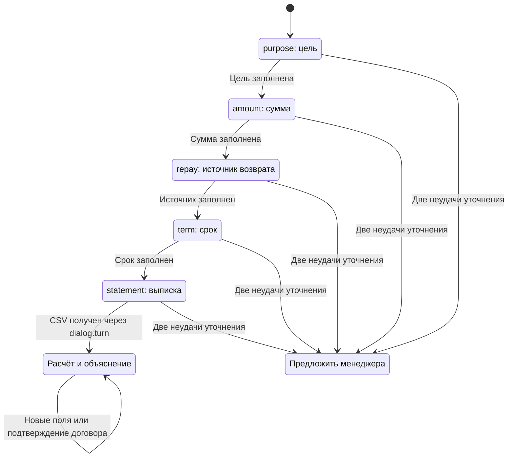
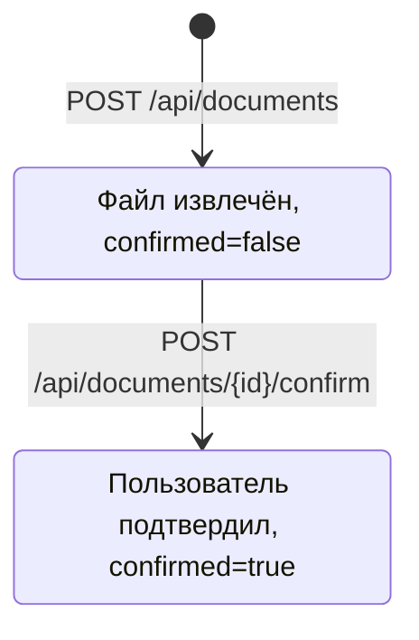
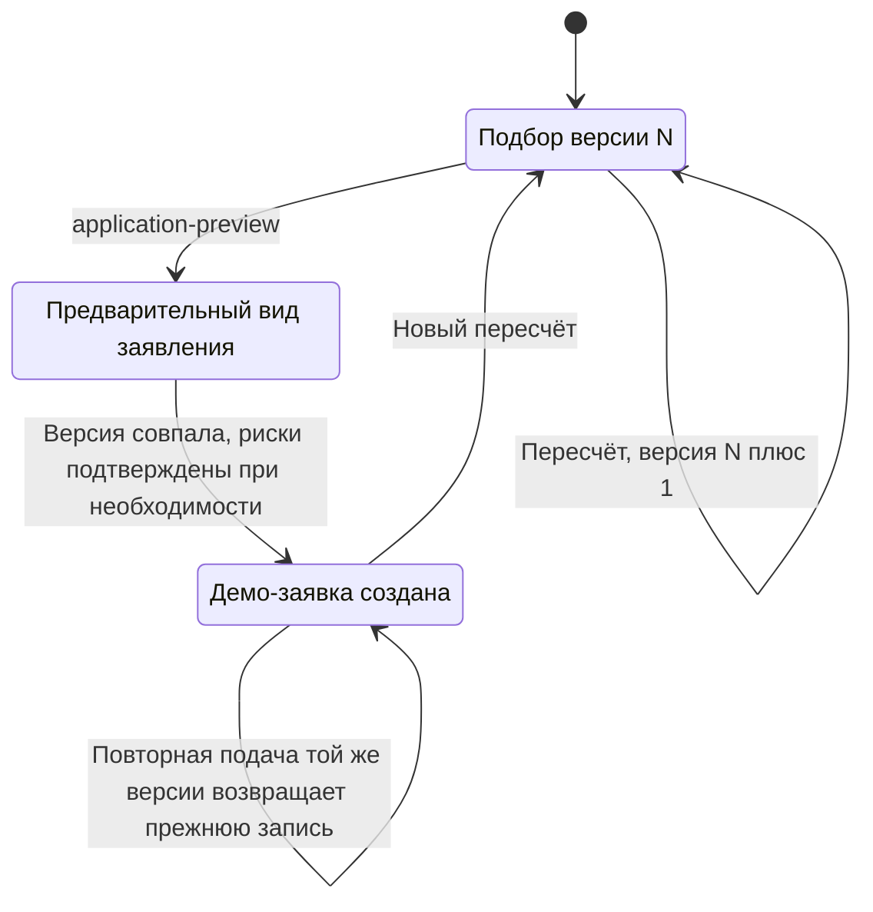

# Состояния по коду

Это три независимые сущности. Единого банковского автомата заявки в репозитории пока нет.

## Результат ядра

`core.py` возвращает русское `core.status`, `translate.py` переводит его в `view.status`. Каждый расчёт создаёт новый результат, переходы ниже показывают выбор исхода, а не запись изменения банковской заявки.

Стоп-правила, DSCR, инструмент и лимиты определяет код, LLM статус не выбирает. «Можно подавать» не означает «одобрено». Основания: [core](../context/core.md), [stop-rules](../context/stop-rules.md), `services/ml-model/translate.py`.

## Слоты диалога агента

Это порядок `next_slot`, заполненные поля пропускаются. Номер попытки 1: первый вопрос, 2: переформулировка, 3 и далее: предложение менеджера. `Offer` обозначает текст ответа, отдельного поля состояния для передачи нет. Ошибка ядра оставляет сессию для повтора. HTTP-статус ответа агента в JSON: `collecting`, `ready` либо `view.status`; это не HTTP-код и не банковское решение. В `/turn` нет поля attachment, поэтому веб-диалог не завершает шаг выписки.

## Документы и демо-заявка Толи

Документ хранится в `files` и `users.state.documents`. Повторная загрузка того же файла тем же пользователем возвращает прежний документ (id из SHA-256). При подтверждении нового документа старые подтверждённые документы той же категории исключаются из JSON-списка; исходные BLOB этим обработчиком не удаляются. Подтверждение пользователем не равно банковской проверке подлинности.

Единственный явный `lead.status`: `Демо-заявка создана`. В legacy `/leads` и `/consultations` поле status отсутствует. `funding_applications` хранит неизменный JSON-снимок версии, уникальный по пользователю, подбору и версии. Несовпадение `expectedVersion` даёт 409, неподтверждённый обязательный риск даёт 422. Оценка подбора `assessment.decision`: `consider`, `reduce`, `unnecessary`, `rethink`, `insufficient`; уровни: «Ориентировочная», «Предварительно обоснованная», «Расширенная». Это оценка сценария, не этапы рассмотрения.

## Чего нет и что делаем

Банковские исходы «одобрено», «иные условия», «дозапрос», «отказ» пока отсутствуют как автомат, API и сохранённые состояния. Подписание, реальная отправка в банк, выдача и очередь менеджера отсутствуют. План для решения человеком: определить контракт рассмотрения, хранить состояние и историю переходов, привязать дозапрос к документам, описать роли и проверки переходов. До реализации демонстрируем только локальную демо-заявку и расчёт готовности.
