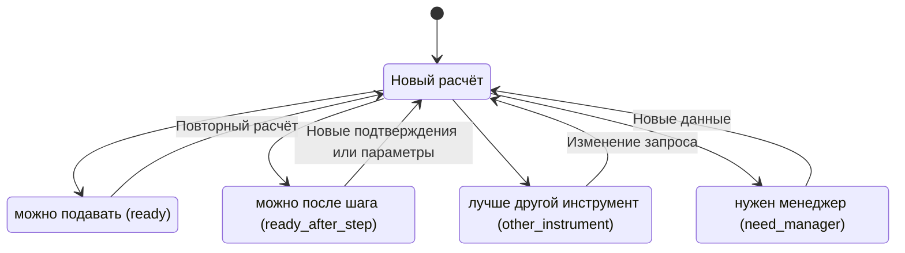
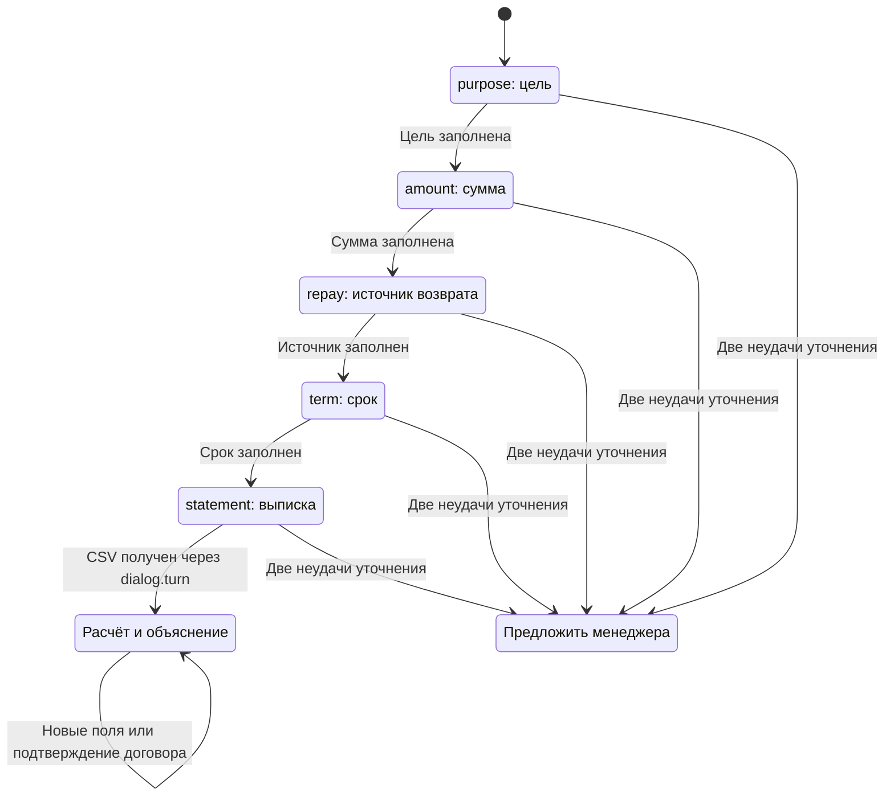
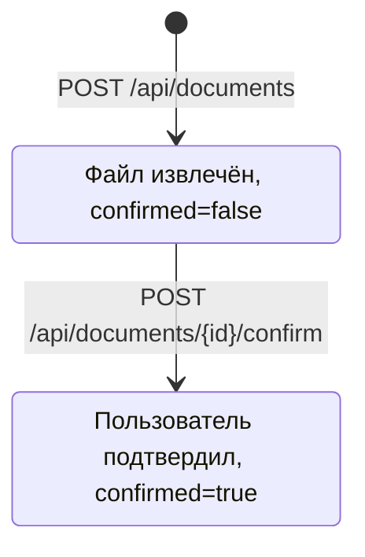
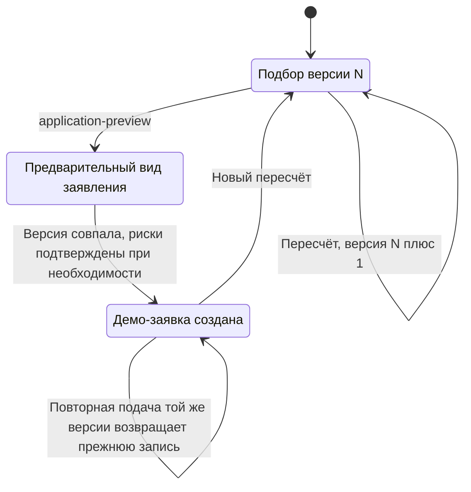
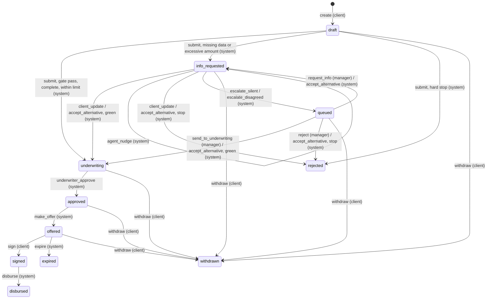

# Состояния по коду

The bank application machine is implemented in `hw/tolya/alfa-intellect/server/applications.ts`. Core results, dialog slots and legacy funding previews below are separate entities.

## Результат ядра

`core.py` возвращает русское `core.status`, `translate.py` переводит его в `view.status`. Каждый расчёт создаёт новый результат, переходы ниже показывают выбор исхода, а не запись изменения банковской заявки.

Стоп-правила, DSCR, инструмент и лимиты определяет код, LLM статус не выбирает. «Можно подавать» не означает «одобрено». Основания: [core](../context/core.md), [stop-rules](../context/stop-rules.md), `services/ml-model/translate.py`.

## Слоты диалога агента

Это порядок `next_slot`, заполненные поля пропускаются. Номер попытки 1: первый вопрос, 2: переформулировка, 3 и далее: предложение менеджера. `Offer` обозначает текст ответа, отдельного поля состояния для передачи нет. Ошибка ядра оставляет сессию для повтора. HTTP-статус ответа агента в JSON: `collecting`, `ready` либо `view.status`; это не HTTP-код и не банковское решение. В `/turn` нет поля attachment, поэтому веб-диалог не завершает шаг выписки.

## Документы и демо-заявка Толи

Документ хранится в `files` и `users.state.documents`. Повторная загрузка того же файла тем же пользователем возвращает прежний документ (id из SHA-256). При подтверждении нового документа старые подтверждённые документы той же категории исключаются из JSON-списка; исходные BLOB этим обработчиком не удаляются. Подтверждение пользователем не равно банковской проверке подлинности.

Единственный явный `lead.status`: `Демо-заявка создана`. В legacy `/leads` и `/consultations` поле status отсутствует. `funding_applications` хранит неизменный JSON-снимок версии, уникальный по пользователю, подбору и версии. Несовпадение `expectedVersion` даёт 409, неподтверждённый обязательный риск даёт 422. Оценка подбора `assessment.decision`: `consider`, `reduce`, `unnecessary`, `rethink`, `insufficient`; уровни: «Ориентировочная», «Предварительно обоснованная», «Расширенная». Это оценка сценария, не этапы рассмотрения.

## Bank application v2

Source: [frozen v2 contract](v2-contract.md). `TRANSITIONS` is the sole transition table;
`transition(from,event,role,target?)` checks every persisted outcome against it.

| Event | From | Caller | Persisted outcome and guard |
|---|---|---|---|
| create | none | client | draft, owned selection version |
| submit | draft | client/system | underwriting, info_requested, rejected; consent=true |
| client_update | info_requested | client/system | same outcomes, confirmed_fields or stored documents |
| accept_alternative | info_requested, queued | client | same outcomes, option_id from latest dossier; 422 otherwise |
| agent_nudge | info_requested | system | info_requested; nonblank text |
| escalate_silent | info_requested | system | queued, CLIENT_SILENT; nudge after latest info cycle, else 409 |
| escalate_disagreed | info_requested | system | queued, CLIENT_DISAGREED; nonblank client_objections |
| request_info | queued | manager | info_requested; reason |
| send_to_underwriting | queued | manager | underwriting; memo, full dossier, amount within current limit |
| reject | queued | manager | rejected; reason, optional legacy alternative |
| underwriter_approve | underwriting | system | approved; complete passed dossier, principal within request and limit |
| make_offer | approved | system | offered; same guards, rate/term/schedule validation |
| sign | offered | client | signed; demo code 0000 |
| disburse | signed | system | disbursed |
| expire | offered | system | expired; strictly older than OFFER_TTL_DAYS |
| withdraw | draft, queued, info_requested, underwriting, approved, offered | client | withdrawn |

`submit`, `client_update`, `accept_alternative` always run compliance first with clock
and stored document dates. A non-pass gate persists its entire report and skips core/BKI.
On pass: core then BKI. 90+ overdue rejects; 30+ or unavailable BKI leaves a bki hole.
Hard core stops reject, SHORT_STATEMENT requests statement data. Holes precede alternatives.
Excessive amount requests alternatives even if the builder returns an empty array.
A green decision persists underwriting, approved and offered in one transaction, all system.
HTTP send_to_underwriting cascades to offered; HTTP sign cascades to disbursed. Internal
transitionApplication keeps individual non-scoring transitions available for orchestration.
Async calls happen before BEGIN IMMEDIATE; CAS is checked again inside the transaction.

Dossier SQL columns remain compatible. `checks._v2` JSON stores the full compliance report
and alternatives; reads expose `dossier.compliance`, `dossier.alternatives` and
`dossier.client_objections` (from the persisted escalation event). No schema migration is
needed; legacy JSON has empty alternatives. Raw core_result stays untouched. N/M comes
from the server checklist, never from additional fields returned by core.

The queue contains only queued applications. Priority uses min(request amount, current
core limit), multiplied by N/M and divided by 1+holes, plus PRIORITY_AGING_K times hours.
A missing core limit contributes zero principal to priority. Queue rows expose red_reason,
client_objections, alternatives, N, M, holes and checks. Rejected applications are listed
separately with UNDERWRITING_REJECTED and reason. No terminal state has outgoing edges.

There is no agent account role in the session schema. Minimal HTTP delegation permits an
owned client session to request only agent_nudge, escalate_silent and escalate_disagreed;
these journal entries use system. A manager cannot delegate them, and foreign client
ownership is checked first. Other system actions remain internal and cannot be forged
through payload.actorRole. The Python agent must carry the client's existing session;
a standalone service-token endpoint is not implemented here.

Every HTTP event requires Idempotency-Key and expectedVersion. Replay returns the original
response before rescoring. Response cache, dossier, parameter changes and all cascade
events commit atomically. Stale concurrent updates get 409 and cannot create another offer.
