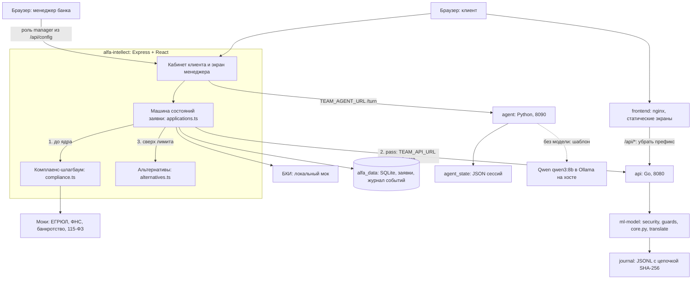
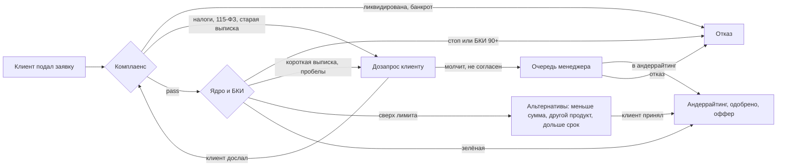
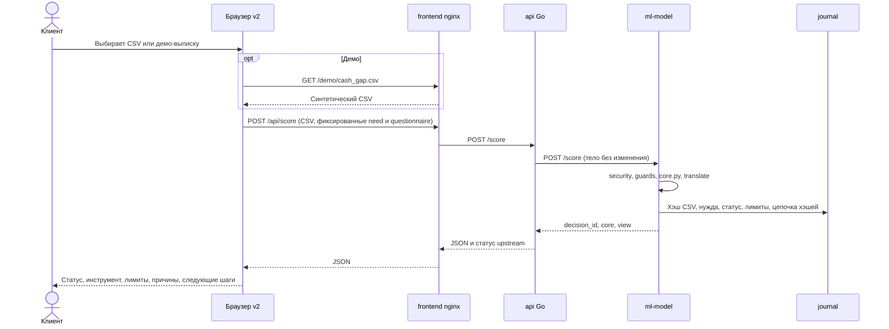
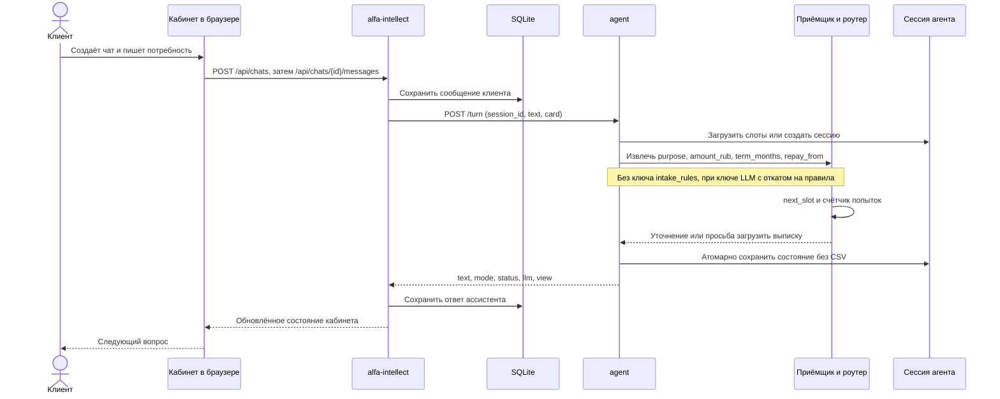

# Архитектура по коду

Срез 23.10.2026, v2: банковская сторона. Сервисы и ограничения: `docker-compose.yml`. Контракт v2: [v2-contract.md](v2-contract.md), состояния заявки: [application-states.md](application-states.md). Агентная часть следует [архитектуре автора](../context/agent-architecture.md), без изменения принятого workflow.

Путь заявки в v2. Зелёную решает система без менеджера, менеджеру уходит только красная.

API не оркестрирует агента, а проксирует `/score`. Кабинет вызывает агента сам. Внешние порты: frontend, Go и кабинет; ml-model привязан к loopback, agent доступен только внутри Compose. TLS стенда не настраивается этим compose. Три именованных volume разделяют SQLite, журнал и сессии. Суммарные `mem_limit`: 864M; пересмотр у Артёма.

## Клиент считает выписку в v2-чате

LLM в этом сценарии не вызывается. Клиентский таймаут 35 с, прокси и Go ждут ядро до 30 с. Ошибка журнала логируется и не отменяет расчёт.

## Клиент кабинета Толи говорит с агентом до расчёта

Карточка передаёт только разрешённые поля подбора, категории/периоды документов и обязательства. Имена, ИНН и файлы целиком в неё не входят. При полном наборе цели, суммы и срока сервер задаёт временный источник возврата «поступления бизнеса, уточнить по выписке». Первичная анкета агента фиксирована как ООО старше трёх лет, а не взята из профиля.

`dialog.turn` умеет принимать вложение CSV и затем вызывать ядро: приёмщик → роутер → `core_http → api → ml-model` → объяснялка → страж. Но HTTP `/turn` передаёт в `dialog.turn` только текст; загрузка документа кабинета туда не подключена. Полный цикл реализован в прямых вызовах и eval, а веб-сценарий выше ограничен сбором потребности. Две неудачи уточнения приводят к предложению менеджера, не к реальной передаче сотруднику.

В Compose `AGENT_CORE_URL` ведёт к Go. На ноутбуке/eval без этой переменной `core_local` вызывает `app.decide`. Guard отбрасывает выдуманные цифры, обещания и слово «одобрено», заменяя объяснение шаблоном. Сессия сохраняет trace, view и слоты; после рестарта CSV требуется повторно.
