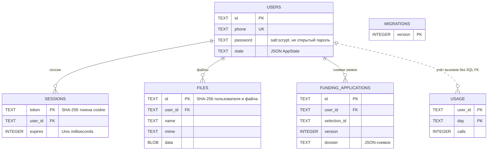
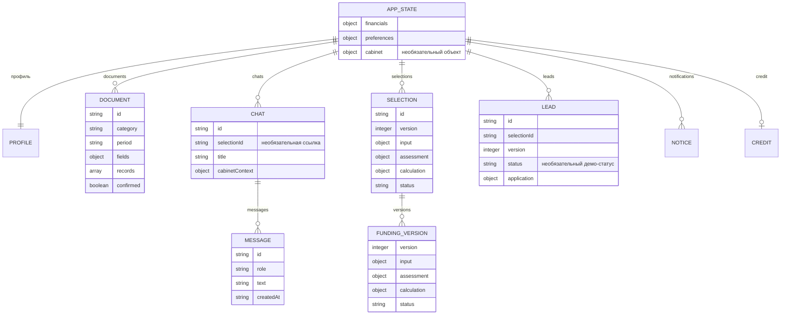
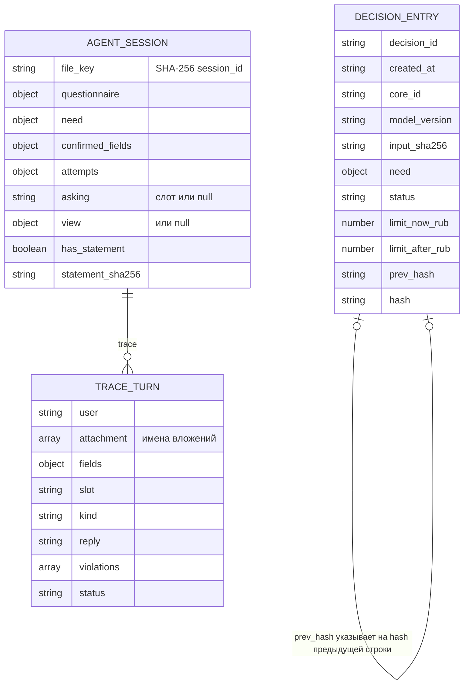

# Модель данных

Источники: `server/store.ts`, миграция 2 в `server/funding-routes.ts`, `shared/types.ts` кабинета; `services/ml-model/journal.py`, `services/agent/server.py` и `dialog.py`. Объекты JSON показаны отдельно от SQL-таблиц.

## SQLite кабинета

`users.phone` уникален, обязательны phone/password/state. Сессии живут 7 дней, cookie HttpOnly и SameSite=strict; Secure зависит от настройки. В `funding_applications` уникальна тройка `(user_id, selection_id, version)`; SQL FK есть только на users, таблицы selections нет. `usage` имеет составной PK `(user_id, day)`, SQL FK не объявлен. SQLite включает WAL и foreign_keys. Версии миграций: 1 и 2. Файл: `DATABASE_PATH`, в Compose именованный volume `alfa_data`.

## Содержимое users.state

JSON-связи не обеспечены SQL FK. `lead.selectionId` может быть `consultation`. `financials` содержит числа и строки источников. Профиль хранит подтверждённый пользователем `registryRecord`, документ хранит извлечённые значения и отметку подтверждения. Чат и подбор связываются через selectionId; версии mvp-2 сохраняются внутри одного подбора. Старый путь сохраняет отдельный parentId. В SQLite лежат сами файлы; в журнале ядра их нет.

## Журнал решений и сессия агента

Журнал append-only JSONL по `JOURNAL_PATH`, первый prev_hash равен 64 нулям. `hash` считается по полям строки до добавления самого hash. Проверка `journal.verify()` обнаруживает нарушение цепочки; это не внешняя нотариальная фиксация. Сырая выписка не сохраняется, но need сохраняется.

Сессия лежит в оперативном `SESSIONS` и `AGENT_STATE_DIR/sessions/<sha256(session_id)>.json`, пишется атомарно. `statement_csv` существует только в памяти и исключается при записи. Trace содержит реплики, поля и ответы, поэтому не является обезличенной телеметрией. После рестарта слоты и view восстанавливаются, CSV для нового расчёта нужно загрузить повторно. HTTP session_id соответствует id чата кабинета; SQL FK между хранилищами нет. Сырой session_id также попадает в технический лог агента.
