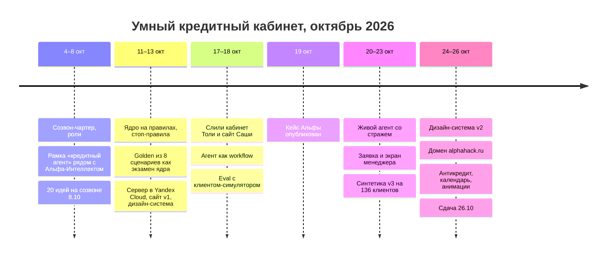
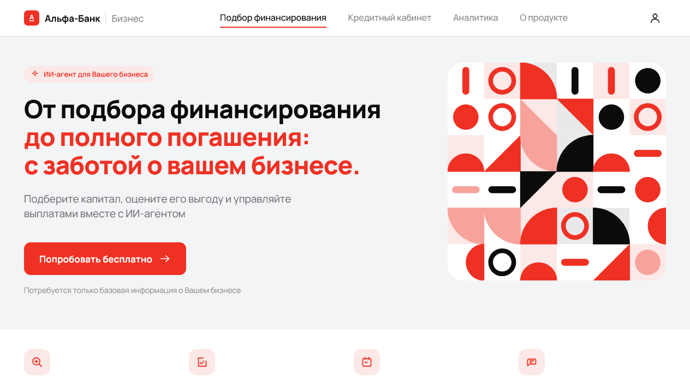
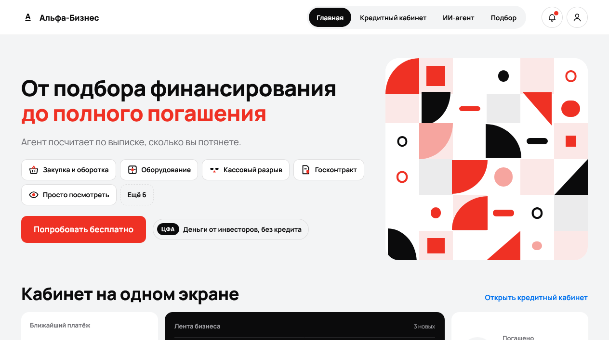
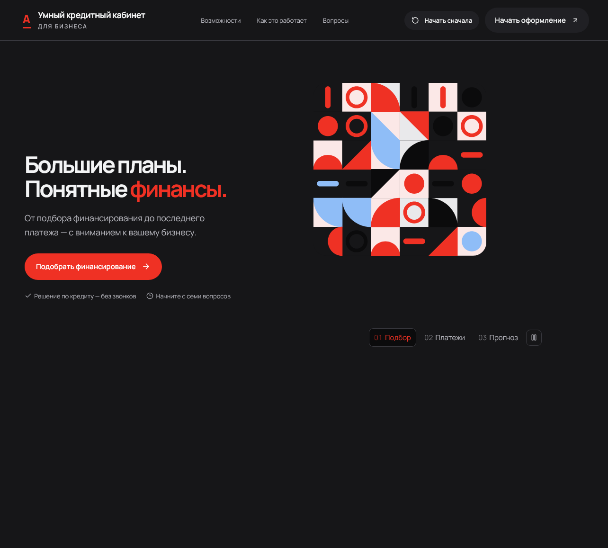
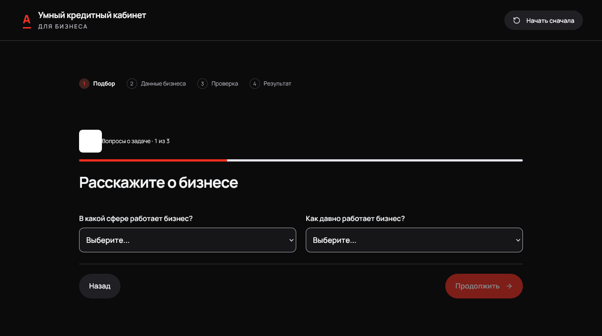
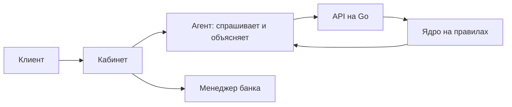

# О проекте: как мы его делали

Пять человек, три недели, один кабинет. Ниже путь от первого созвона до сдачи, ключевые выборы и честные ограничения.

## Путь

## Как выглядело

| v1, 13 окт | v2, 17 окт |
|---|---|
|  |  |
| **Сдача, 26 окт: главная** | **Сдача, 26 окт: подбор** |
|  |  |

## Кто что сделал

| Кто | Вклад |
|---|---|
| Саша | капитан, агент и eval, контракты, golden, выкатка |
| Лиза | ядро скоринга: поток, DSCR, стоп-правила, коды причин |
| Толя | кабинет клиента и менеджера, заявка, подбор продуктов |
| Тёма | API на Go, хранилище, безопасность, Docker |
| Тоня | концепт, путь предпринимателя, тексты, макеты |

Код писали люди вместе с ИИ-ассистентами (Claude, Codex): человек ставит задачу и принимает работу прогоном тестов, а не по отчёту ассистента.

## Ключевые выборы

**Ядро на правилах, а не нейросеть.** Решение о готовности должно объясняться по пунктам и проверяться тестами. Ядро считает поток по выписке, DSCR со стрессом −30% выручки и стоп-факторы. LLM статус не выбирает.

**Агент как workflow.** Приёмщик → код-роутер → ядро → объяснялка → код-страж. Без модели агент работает на шаблонах, поэтому прототип не падает, если LLM недоступна.

**Модель.** Qwen с открытыми весами, как требует кейс. Подключается тремя строками в `.env` через любой OpenAI-совместимый API: OpenRouter или Yandex AI Studio. DeepSeek и OpenAI отпали: первый по нашему решению, второй недоступен с российского сервера.

**Сервер.** Одна ВМ в Yandex Cloud на 4 ГБ RAM, весь стек в Docker Compose с потолками памяти у каждого контейнера. В простое стек занимает около 190 МБ. HTTPS через Caddy и Let's Encrypt, домен alphahack.ru.

## Ограничения

- Данные клиентов синтетические, банковские системы (АБС, бюро, ЕГРЮЛ) смоделированы, список в [THIRD_PARTY_NOTICES](../THIRD_PARTY_NOTICES.md).
- Ядро проверено на golden и синтетике v3, на реальных выписках не калибровалось.
- Решение по кредиту за банком: кабинет показывает готовность «сейчас и после шага», а не одобрение.
- Как продукт встраивается в банк: [bank-integration.md](bank-integration.md).
