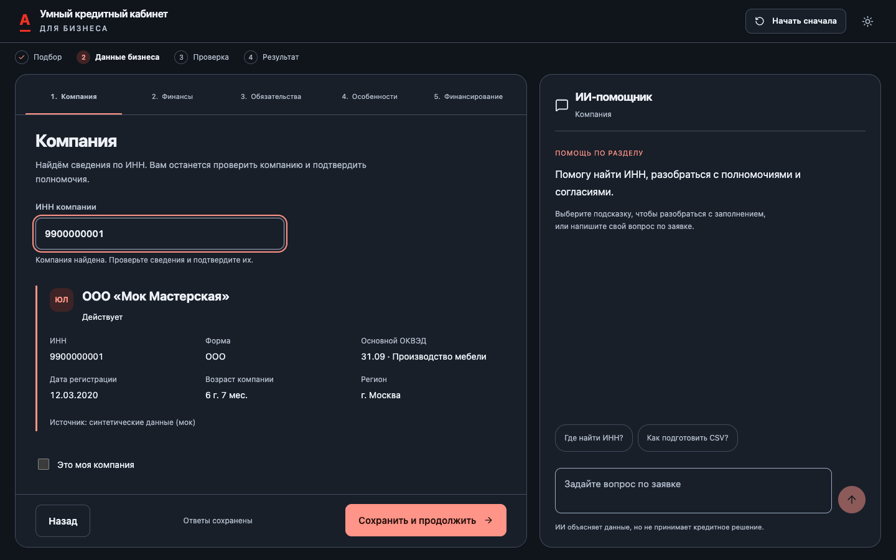

# MVP 2 — UX/UI, редакция 3: результат реализации

25.10.2026 · ветка `tolya/structure-v2` · [PR #58](https://github.com/gitAlphaMerge/credit-cabinet/pull/58).

Реализован единый интерфейс существующего приложения, без параллельного деморежима. Сохранены тёмная/коралловая идентичность, HeroFinance, шесть продуктов, банковские правила и четыре кода решения. В `main` изменения не вносились. Приватные исходные ТЗ, базы и пользовательские документы в Git не добавлены; изображения ниже получены в отдельной синтетической QA-сессии.

## 1. Первопричина и новая архитектура

Проблемой были не только размеры CSS: прежняя левая карточка смешивала навигацию, повтор заголовка, прокручиваемую форму и действия. Снаружи оставались ещё заголовок и footer, внутри — механическая попарная сетка. Мобильный вариант просто ставил чат после длинной формы. Подробный предварительный аудит и матрица полей/API: [MVP2_UX3_AUDIT.md](MVP2_UX3_AUDIT.md).

Новый `ApplicationWorkspace` разделяет эти обязанности: навигация и один заголовок, одна внутренняя область прокрутки формы, отдельная нижняя панель действий, независимый чат с закреплённым вводом. На desktop используется сетка 3fr/2fr без внешнего `max-width`. Ограничивается ширина отдельных полей, а не рабочего пространства. На mobile переключаются «Анкета / Помощник» без размонтирования панелей, поэтому ответы и история не теряются.

Сначала создан и проверен эталон «Компания» на 1440×900 и 1920×1080; затем общий компонент применён к остальным разделам. Итоговые измерения браузером:

| Окно | Левая / правая панель | Высота обеих | Нижняя граница |
| --- | --- | --- | --- |
| 1440×900 | 823,19 / 548,80 px | 761 px | 880 px |
| 1920×1080 | 1111,19 / 740,80 px | 941 px | 1060 px |

При визуальной проверке найдены и исправлены наложение длинных мобильных вкладок, выход скрытого file-input за пределы формы, обрезание длинной истории чата и неправильная позиция истории после открытия мобильной панели. Повторная проверка контролирует отсутствие горизонтального и внешнего вертикального переполнения workspace.

## 2. Изменённые экраны и компоненты

- Общая карта пути `JourneyProgress`, отдельный локальный прогресс трёх экранов знакомства. Онбординг получил сбалансированную композицию без растягивания короткой формы; обещание полного пути «за 3 минуты» удалено.
- Вводный экран, пять разделов анкеты, досье и дозапрос используют общую рабочую область. Лишний footer оформления и повторные заголовки удалены.
- «Компания»: автоматический поиск и состояния ИНН сохранены; карточка реестра, подтверждение «Это моя компания», уточнение ошибок и согласия сгруппированы по смыслу. Если расшифровки ОКВЭД нет в источнике, это явно указано, а не придумано.
- «Финансы»: образец CSV, инструкция выгрузки, отдельные счета и файлы, реальные состояния загрузки/разбора, ошибки конкретного файла, недостаточная история, замена/удаление, фактически извлечённые суммы и период. Можно перейти к финансовому согласию и вернуться. Можно продолжить без CSV с последующим дозапросом.
- «Обязательства» и «Особенности»: компактные варианты «Да / Нет / Не знаю», только активные дочерние поля, единицы и периоды. Неизвестные сведения допускают неполный ввод и не превращаются в фиктивные нулевые показатели.
- «Финансирование»: сначала сохранённая сводка «Ваш запрос», затем явное «Изменить». Повторного заполнения знакомства нет. Сохраняются продуктовые диапазоны и специальные поля линий, овердрафта, рефинансирования и инвестиционного кредита.
- Ошибки: короткая сводка со ссылками и фокусом на поле, сообщения рядом с вводом; повтор сохранения не стирает несохранённые ответы. Статус сохранения привязан к реальной операции.
- Досье: четыре карточки с возвратом в нужный раздел; отсутствие CSV отдельно обозначено. Обработка показывает реальные стадии без фиктивного процента. Результат отделяет запрошенную сумму от рассчитанной доступной; подробности раскрываются отдельно.
- Договор/получение: сохранены просмотр PDF, скачивание, запись синтетической подписи, отдельный акт выдачи. Для линии используются подписи «Условия использования лимита» / «Открыть лимит», а не обещание полной аннуитетной выдачи.

Основные новые файлы: `src/ApplicationWorkspace.tsx`, `src/JourneyProgress.tsx`, `src/journey-workspace.css`, `shared/application-help.ts`. Основные переработанные: `src/Mvp2.tsx`, `src/ApplicationAgent.tsx`, `src/StatementUpload.tsx`, `src/ClientDossier.tsx`, `src/CompanyCard.tsx`, `src/DataConsent.tsx`.

### Справочная помощь и backend-стыки

Единый каталог подсказок содержит контекст/условия, кнопку, отправляемый вопрос, тип ответа, шаблон, источник и fallback при отсутствии данных. Темы: компания, CSV/период, обязательства, будущие операции, условия, валидация, недостающие данные, причины сохранённого решения и расхождения выписки.

Одно нажатие действительно отправляет вопрос и сохраняет ответ. Проверенная справка работает без LLM с отдельным `mode: application-reference` и указанием источника; свободный диалог идёт через прежний провайдер. Передаются раздел, ключ активного поля и ключи ошибок, а не значения персональных полей. При недоступной модели вопрос сохраняется, доступен повтор без дубля; анкета не блокируется. При переключении контекст меняется, история сохраняется.

В `server/mvp2-routes.ts` добавлены справочные ответы и метаданные фактических операций CSV. Новый versioned DELETE удаляет конкретную выписку только в редактируемой заявке, после проверки владельца. `statementsOf` учитывает только документы активных счетов: архивная строка удалённого счёта больше не участвует в текущей оценке. Это исправление состава исходных данных, не изменение формулы или порогов. Миграций схемы в этой редакции нет.

## 3. Соответствие ТЗ и проверкам

| Пункты ТЗ | Реализация / сохранённый контракт | Проверка |
| --- | --- | --- |
| 1: единый путь и запрет кабинета до выдачи | прежний backend-gate и отдельная оболочка оформления; ни регистрации, ни старых кабинетных вкладок до ACTIVE | `check-mvp2.cjs`: прямые URL, подпись без доступа, выдача и кабинет; `check-mvp2-branches.cjs`: менеджеру договор недоступен |
| 1: четыре решения, граница 3 млн | коды и численные правила не менялись | ровно 3 млн → APPROVED; положительная сумма выше → MANAGER; отрицательные 5 млн → DECLINED; неполные данные → ADDITIONAL |
| 2: полноразмерные 60/40, внутренние scroll, mobile | `ApplicationWorkspace`, фиксированные действия, отдельный ввод/история чата, переключение без потери | сначала `check-ui3-company.cjs`, затем `check-ui3.cjs`; геометрия выше, все шесть ширин |
| 3: 7 вопросов / 3 экрана, точная сумма и понятные enum | общий/локальный прогресс; синхронный ввод и ползунок, неизвестная сумма, прежний контракт каталога | `check-mvp2-ux.cjs`: 3 478 123 ₽, неизвестная сумма, сохранение, диапазоны; `check-mvp2.cjs`: полный онбординг |
| 4: подбор → рекомендация/каталог → вводный экран | существующая реальная операция подбора сохранена; три разных этапа, без выдуманной проверки или задержки | `check-mvp2.cjs`; `check-mvp2-ux.cjs`: ошибка сети при подготовке, без обхода |
| 5.1: ИНН, источник, подтверждения, согласия | debounce/контроль формата/реестр; карточка фактов, понятные состояния | `check-mvp2-ux.cjs`, `check-ui3-company.cjs`, `check-ui3.cjs` |
| 5.2: CSV по счетам, состояния, отсутствие согласия | образец, инструкция, same-bank accounts, локальные ошибки, удаление и исходные суммы | `tests/mvp2-ui3.test.ts`; `check-ui3.cjs`: плохой / короткий / полный CSV, согласие и возврат |
| 5.3–5.5: активные ветви и отсутствие повторного опроса | сегменты, условные поля, сводка запроса с редактором | `check-mvp2-ux.cjs`, `check-ui3.cjs`: да → частично → нет, даты/лимиты/редактор |
| 6: ошибки, сохранение, восстановление | inline + связанные ошибки, приватный draft, повтор без сброса | unit/API и browser: ошибки/фокус, reload, файлы/раздел, обработка; `check-journey-restart.cjs` |
| 7: рабочий агент, одно нажатие, честный offline | отдельный справочный mode, единый каталог/источники, прежний LLM-chain | `tests/mvp2-ui3.test.ts`: каталог/нет списания AI-квоты/ретраи; браузер: одно нажатие, история/мобильный возврат/offline |
| 8: досье, реальный конвейер, четыре CTA | четыре карточки; сохранённый snapshot, фактические статусы; дозапрос той же заявки/альтернатива с новой проверкой | `check-mvp2.cjs`, `check-mvp2-branches.cjs`, `check-mvp2-ux.cjs` |
| 8: договор → подпись → получение → кабинет | реальная работа существующих синтетических backend-операций; идемпотентная активация | `check-mvp2.cjs`: PDF, подпись, отдельная выдача, один кредит и существующий кабинет |
| 9–10: визуальная приёмка и регрессия | сохранённая палитра, focus/reduced motion, цели нажатия, устранение найденных переполнений | шесть ширин + desktop-прототип; тесты темы G5; изображения ниже |

## 4. Скриншоты

### Эталон и мобильная панель

[Компания, 1920×1080](screenshots/ui3/company-1920.png) · [Анкета, 390 px](screenshots/ui3/company-390.png) · [Помощник, 390 px](screenshots/ui3/assistant-390.png).

### Остальной путь

[Онбординг](screenshots/ui3/onboarding.png) · [Вводный экран](screenshots/ui3/intro.png) · [Финансы](screenshots/ui3/finance-1440.png) · [Сводка запроса](screenshots/ui3/request-1440.png) · [Обработка](screenshots/ui3/processing.png) · [Решение на мобильном](screenshots/ui3/decision-mobile.png) · [Договор](screenshots/ui3/contract.png) · [Получение средств](screenshots/ui3/receive.png) · [Кабинет после выдачи](screenshots/ui3/cabinet.png).

## 5. Проверки и сквозные результаты

Проверено на отдельной базе/анонимных сессиях `localhost:4175`, с настоящим локальным ядром Лизы (`core_id=liza`), а не подменой ответа API. Пользовательскую сессию `4174` для тестов не сбрасывали.

| Проверка | Результат |
| --- | --- |
| `npm run build` (TypeScript + production build) | PASS; предупреждение Vite о bundle >500 kB остаётся |
| `MVP2_LIVE_CORE_URL=http://127.0.0.1:5001 npm test` | **955/955 PASS**, 0 skipped test cases; в том числе live MVP2 и provider/process контрактные тесты |
| G5 тема / контраст / переключение | **8/8 PASS** |
| `check-ui3-company.cjs` | PASS, desktop-эталон проверен до остальных разделов |
| `check-ui3.cjs` | PASS: 360/390/768/1280/1440/1920, геометрия, CSV, действия агента, ошибки, сохранность |
| `check-mvp2.cjs` | PASS: анонимный путь до APPROVED → договор → подпись → выдача → кабинет |
| `check-mvp2-branches.cjs` | PASS: менеджер/запись, дозапрос и повтор, отрицательные 5 млн/альтернатива, комплаенс-отказ без обхода |
| `check-mvp2-ux.cjs` | PASS: точная/неизвестная сумма, автопоиск, upload, условные ветви, диапазоны, reload обработки |
| `check-journey-restart.cjs` | PASS: подтверждение/отмена, ошибка сети/повтор, новая сессия, старые вкладки, мобильный header, пустое знакомство после reload |
| `git diff --check` и Prettier для изменённых кодовых файлов | PASS |
| Полный `npm run format:check` | FAIL: существующий форматный долг **46 файлов**, не относящиеся к этой правке файлы массово не форматировались |
| `python3 data/check_golden.py` | **4/8**, см. ограничения; ядро не изменено |

Новые автоматические тесты: `tests/mvp2-ui3.test.ts` (справочный каталог/ретраи, контракт неполных данных, CSV/владение/версии/удаление) и `tests/ui3-workspace.test.tsx` (структура workspace, mobile controls, карта пути, отсутствие придуманной расшифровки).

Отдельный старый live-suite S1/S4 обращается к жёстко заданному порту 5000 и не запускался: `/health` вернул 403. Поэтому 955 — число фактически выполненных test cases, а не утверждение о прохождении этого suite. При обычном `npm test` без `MVP2_LIVE_CORE_URL` итог 954 PASS / 1 skipped; явный адрес 5001 включает и успешно выполняет live-тест MVP2 (автоматический путь, менеджер, рефинансирование).

Идентификаторы синтетических заявок последнего прогона: полный путь `3cff3521-feb2-45dc-bde2-94b1d5e91358`; UX/дозапрос с менеджером `f630138d-9715-4b36-9e5c-984f102c030f`; workspace `187b681e-e52a-4dba-98e9-fe1b7ed9e684`. В браузерных прогонах не зарегистрированы ошибки выполнения страницы.

## 6. Ограничения и запуск для просмотра

- Свободный персонализированный LLM-диалог требует работающей конфигурации модели. На проверенном стенде внешняя модель не настроена: справочные подсказки отвечают, свободный вопрос честно показывает недоступность и допускает повтор. Успешный живой LLM-диалог здесь **не заявляется**. Защищённая цепочка выбора/запуска агента не менялась.
- Реестры, кредитная история, подпись и выдача остаются синтетическими согласно границам MVP. Реального банковского перевода и регистрации нет.
- `data/check_golden.py` остаётся красным в `cash_gap_small`, `equipment_leasing`, `short_history`, `cash_out`. Неизменённое ядро и эти расхождения требуют работы владельца ядра; успешный UI/E2E не означает, что golden-набор исправлен.
- 46 существующих форматных замечаний не устранены. Предупреждение о размере JS bundle также остаётся; разделение сборки не входило в приоритетную композицию анкеты.
- Регулируемый drag-разделитель не добавлен: реализован и проверен основной фиксированный 60/40, как допускает ТЗ. Состав трёх сохраняемых флагов согласий, включая БКИ, и согласованная юридическая формулировка не переписывались; UI раскрывает их смысл, но не утверждает юридическую готовность к реальной выдаче.
- Перед обновлением preview проверены версии схемы 1–7, целостность/FK и отсутствие новых миграций. Сделана консистентная резервная копия `var/backups/mvp2-ui3-2026-10-25/before-preview.sqlite`, режим 0600, вне Git. Существующие данные пользователя сохранены.

Для просмотра запущена актуальная production-сборка на **http://localhost:4174/**. Обновите вкладку. Кнопка «Начать сначала» доступна сверху, но сбрасывает текущий процесс только после подтверждения; автоматический сброс пользовательской сессии не выполнялся.
